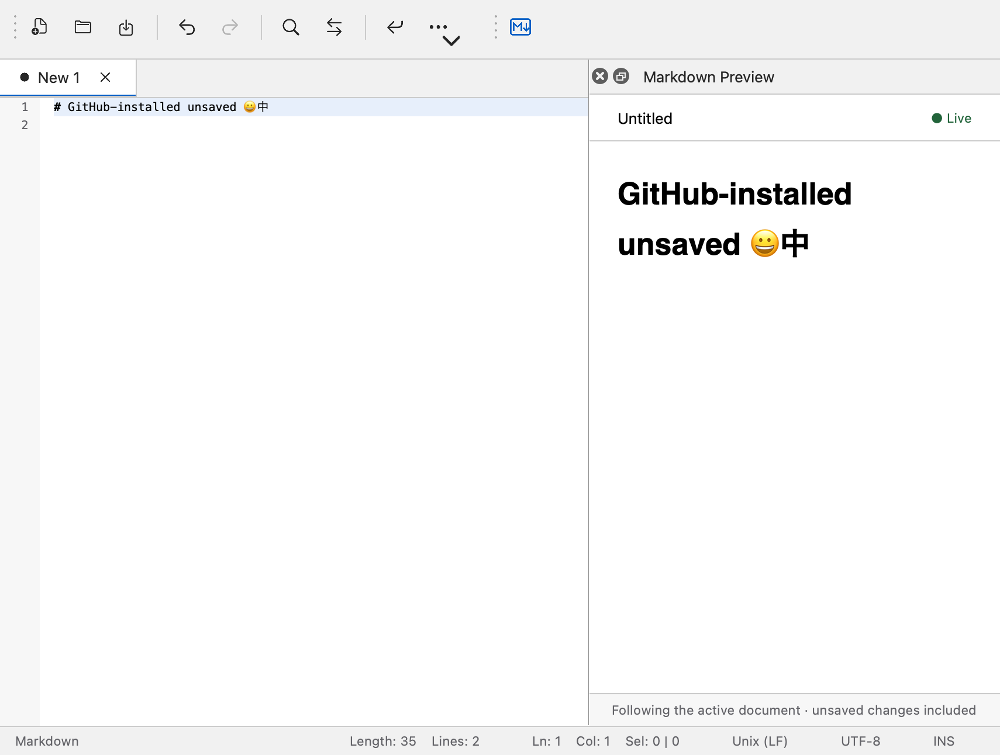

# Notepad Next ++

**Notepad Next ++** is an independently maintained fork of [Notepad Next](https://github.com/dail8859/NotepadNext), maintained by [KMerdan](https://github.com/KMerdan). Notepad Next was created by Justin Dailey and contributors as a cross-platform reimplementation of Notepad++.

The fork includes the JSON-RPC plugin system, plugin SDK, Markdown Preview integration and revised macOS interface. Fork modifications began in October 2026; the source in this repository is modified from upstream. Upstream copyright notices are retained. The application remains licensed under **GPL-3.0-or-later**, as stated in the upstream source notices; the complete license is in [LICENSE](LICENSE). Third-party components retain their own license notices.

Development notes: [Plugin system](doc/PluginSystemPlan.zh-CN.md), [SDK](packages/plugin-sdk/README.md), [plugin lifecycle and fork](doc/plugin-system/LifecycleAndFork.zh-CN.md), [macOS UI review](doc/plugin-system/MacUiReview.zh-CN.md). Build instructions below retain technical target names used by upstream. The displayed product and executable are Notepad Next ++ / NotepadNextPlusPlus; the plugin manifest name and host API stay compatible with existing Notepad Next plugins.

Though the application overall is stable and usable, it should not be considered safe for critically important work.

There are numerous bugs and half working implementations. Pull requests are greatly appreciated.

# Installation

## Development builds

The fork currently ships as source. Build it using the instructions below; a local macOS development build is also described in [the plugin development guide](doc/plugin-system/MacUiGitHub.zh-CN.md). Release packages will appear on [this fork’s Releases page](https://github.com/KMerdan/notepad-next-plus-plus/releases).

The macOS interface uses the system UI font and native symbols. Change the document font and size in **Preferences → Editor**; new profiles default to Menlo. The fork uses its own application identity and preferences directory, so it can coexist with upstream.

# Translations
The fork inherits upstream’s community translations. Report translation changes for this fork through [its own issues](https://github.com/KMerdan/notepad-next-plus-plus/issues); upstream’s translation project remains separate.

# Development
Current development is done using QtCreator with the Microsoft Visual C++ (msvc) compiler. Qt 6.5 is the currently supported Qt version. Older versions of Qt are likely to work but are not tested. Any fixes for older versions will be accepted as long as they do not introduce complex fixes. This application is also known to build successfully on various Linux distributions and macOS. Other platforms/compilers should be usable with minor modifications.

If you are familiar with building C++ Qt desktop applications with Qt Creator, then this should be as simple as opening `CMakeLists` and build/run the project.

If you are new to building C++ Qt desktop applications, there is a more detailed guide [here](/doc/Building.md).

## Plugin system in development

The current working tree adds a native Plugin Manager and independent Node plugin processes connected through JSON-RPC. Single repositories and marketplaces register metadata first; users explicitly install resources from Uninstalled. Installed plugins can be inspected, enabled, disabled, reloaded, updated, rolled back and uninstalled, with optional deletion of plugin-owned data. Background collection removes unused packages and interrupted staging while retaining rollback versions and code still used by another process. [Process supervision](doc/plugin-system/ProcessSupervision.zh-CN.md) covers abnormal parent death on macOS; [bounded diagnostics](doc/plugin-system/Diagnostics.zh-CN.md) preserve session logs and failure categories across restarts. The first-party [TypeScript Markdown preview](examples/markdown-preview/README.md) reads unsaved editor buffers. The [standalone plugin SDK](packages/plugin-sdk/README.md) includes hello/Markdown templates, typed API, source-map debugging, a test host and packaging tools; the [Markdown development walkthrough](packages/plugin-sdk/docs/MarkdownWalkthrough.zh-CN.md) covers creation through local installation. [Author release tools and a CI template](doc/plugin-system/AuthorRelease.zh-CN.md) prepare built ZIPs and same-release SHA-256 checksums; the public [standalone Markdown plugin](https://github.com/KMerdan/notepadnext-markdown-preview) now has verified stable Releases and can be registered, installed and updated by repository URL.

Core plugin support is enabled by default; WebEngine panels require `NOTEPADNEXT_PLUGIN_WEBVIEWS=ON` and Qt WebEngine/WebChannel. Supply the verified pinned Node binary through `NOTEPADNEXT_PLUGIN_NODE` to bundle the runtime. A [Python adapter](doc/plugin-system/PythonAdapter.zh-CN.md) and [buffer-inspector example](examples/python-inspector/README.md) use the same RPC services; developer builds must explicitly configure `NOTEPADNEXT_PLUGIN_PYTHON` with an absolute Python 3.12 interpreter path. The interpreter is not bundled. Set `NOTEPADNEXT_PLUGINS=OFF` for the base editor. Local development does not require Developer ID or notarization. Formal [macOS distribution](doc/plugin-system/MacOSDeployment.zh-CN.md) is deferred; [platform acceptance](doc/plugin-system/PlatformCapabilities.zh-CN.md) records the outstanding platform checks.

To try an unpublished plugin, choose **Register Resources… → Local metadata file** in the manager and select the example's `notepadnext-plugin.json`. Registration adds it to **Uninstalled** without installing or running it. Select **Install Local Package…** to install its built directory, then enable it and use its primary command button in **Installed**. Local sources can be refreshed and inspected through **Sources**. Follow the [Markdown example instructions](examples/markdown-preview/README.md) to build the package and try unsaved previews.

[macOS editor and preview improvements](doc/plugin-system/MacUiGitHub.zh-CN.md) align the main workspace with the Figma layout, including system toolbar symbols, document tabs, light/dark editor colors and live preview context.

See the [implementation and build instructions](doc/plugin-system/Implementation.zh-CN.md), [full technical plan](doc/PluginSystemPlan.zh-CN.md), [completion audit](doc/plugin-system/CompletionAudit.json) and [dependency inventory](doc/plugin-system/Dependencies.zh-CN.md) for evidence and remaining work.

The dedicated [plugin conformance workflow](.github/workflows/plugin-conformance.yml) defines WebEngine, core-only and plugins-disabled checks on Linux, Windows and both Mac architectures. [Runtime preparation and CI evidence](doc/plugin-system/CrossPlatformCI.zh-CN.md) describe pinned archive verification and retained test artifacts. Remote runs are still pending; this workflow does not establish released platform support.

[Reference performance and lifecycle measurements](doc/plugin-system/evidence/MarkdownPerformanceValidation.json) cover 1/5/10 Markdown processes, real editor previews, native handles and process exit. Historical signing records are retained, but formal signing, notarization and publication are outside the current development phase.

A bounded [VS Code adapter](doc/plugin-system/VSCodeCompatibility.zh-CN.md) imports built CommonJS extensions, provides synchronous command disposables and document reads, applies Unicode edit transactions, and owns Qt messages and full HTML Webviews. The unmodified MIT [official HelloWorld sample](examples/vscode-hello-world/README.md) runs through the actual manager and bundled host; an explicitly [adapted MIT Cat Coding sample](examples/vscode-webview/README.md) exercises local JS/CSS/images and browser messaging. Compatibility is limited to the documented API subset. Bounded [context persistence and private plugin configuration](doc/plugin-system/VSCodePersistence.zh-CN.md) are also available; local macOS relocation passes, while named workspaces, broader acceptance and a notarized release remain pending.

# License
This code is released under the [GNU General Public License version 3](https://www.gnu.org/licenses/gpl-3.0.txt).
