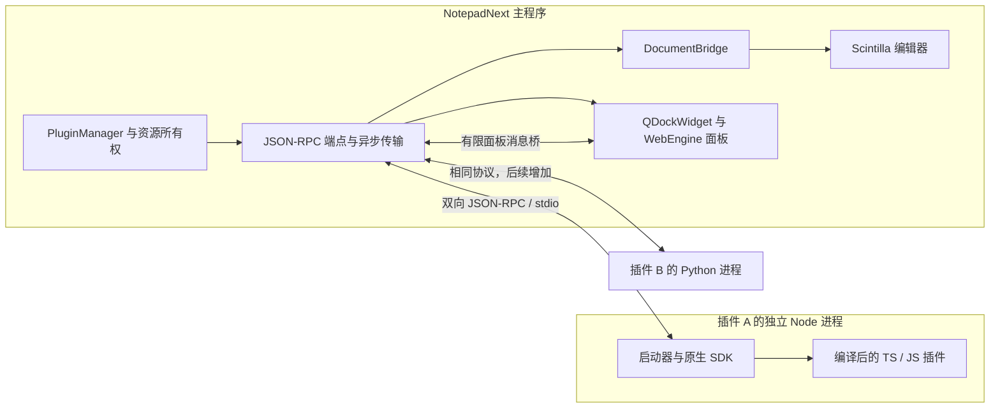
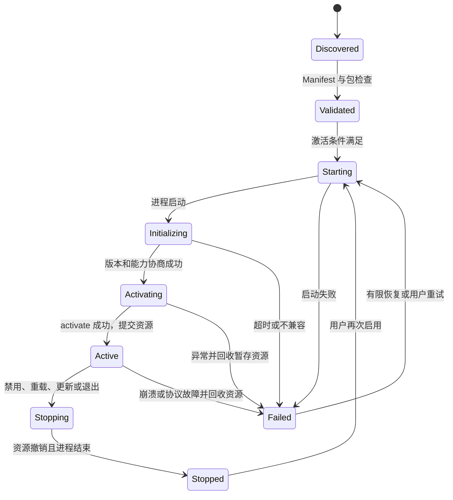
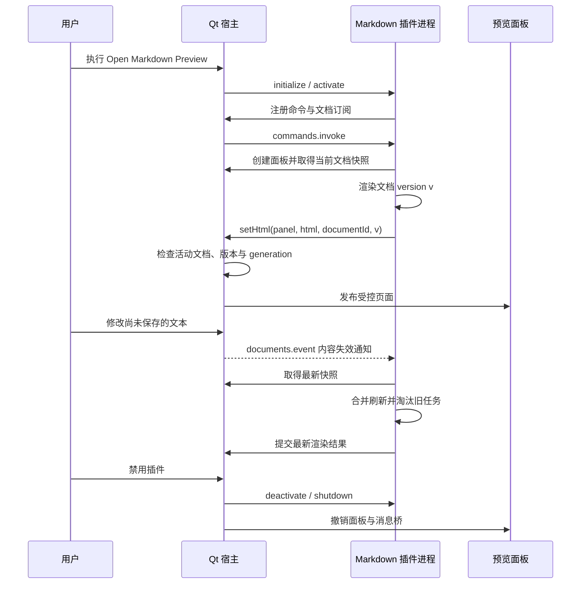

# NotepadNext 插件系统技术策划

**2026-10-12 方向修订：** SDK 以 Notepad Next ++ 现有编辑功能的原生公开 API 为目标。最新 [原生 SDK 设计](plugin-system/NativeSDKDesign.zh-CN.md)优先于本文旧的 VS Code 兼容目标；原有适配实现作为实验记录，不继续作为 SDK 核心依赖。当前先进行设计评审，分仓和新增发布暂停。

当前阶段（2026-10-11 用户明确修订）：**本机开发与插件功能验收**。编译、运行、热插拔及开发测试不要求 Developer ID、Apple 公证或发布。正式签名、公证、安装介质发行和面向最终用户的部署验收移入后续发行阶段，不阻塞当前开发；本文原 I4 发行内容保留为未来参考。需要本地打包时使用默认 ad-hoc 签名 `-`，无需开发者证书；不配置或提交 notarytool 凭据。

研究日期：2026-10-10。研究代码基线：`adfd128`，应用版本 `0.15`。本文保留完整交付要求；当前方法和预算属于未正式发布的 0.1 profile。2026-10-11 实施进展：统一 metadata；单插件与 Marketplace 都先注册资源，进入 Uninstalled 后由用户选择安装。资源注册、Qt 管理器、本地／GitHub Release 安装、JSON-RPC、Node 宿主、Scintilla 文档桥、原生命令和 WebEngine Markdown 已接入。更新／回滚、首次使用验证、健康监督和 100 次启停／重载已在本机验证；33 个业务方法的共享 Schema 与插件配置／数据持久化已接入并验证；包回收、父应用异常退出监督、持久诊断和发行作者校验已接入。作者 ZIP／校验工具与草稿发行 CI 模板已准备；[Python 第二语言原型](plugin-system/PythonAdapter.zh-CN.md)已验证同一未保存文本和独立重载。[有界 VS Code 核心与完整 HTML Webview](plugin-system/VSCodeCompatibility.zh-CN.md)已接入；[有界状态与配置](plugin-system/VSCodePersistence.zh-CN.md)已按单个持久编辑会话接入；完整适配语义、进一步性能／故障验收与正式发行仍待完成，见[实施记录](plugin-system/Implementation.zh-CN.md)和[完成审计](plugin-system/CompletionAudit.json)。

## 1. 推荐方案与交付目标

采用 **Qt/C++ 管理插件及编辑器资源，独立进程执行插件，JSON-RPC 2.0 连接双方** 的架构。首版运行 TS 编译后的 JS，每个启用的插件拥有独立 Node 进程；预览窗口由 Qt 的 `QDockWidget + QWebEngineView` 承载。协议与运行时解耦，后续 Python 或编译型语言使用同一套文档、命令和面板服务。

最先交付的完整体验是：用户安装本地 Markdown 预览插件，打开预览，修改未保存的文本，预览随之刷新；随后可在应用继续运行时禁用、重载和更新插件。插件退出或出错时，编辑器中的文本、撤销栈和会话仍由主程序管理。

插件管理器的目标使用流程还包括：输入 GitHub 仓库 URL，以统一 metadata 注册单插件或 Marketplace 的资源，进入 Uninstalled；用户选择资源并确认安装兼容版本后，启用时出现插件声明的菜单项或工具栏图标，点击入口打开窗口或执行动作。I1 用本地包验证这条命令和 UI 路径，I2 增加 GitHub 安装来源及完整管理。入口可以在插件进程尚未启动时显示，第一次点击才激活插件。

VS Code 插件复用通过单独的 API 适配层实现。范围以经过验证的插件和 API 清单为准：先支持命令、基础文档读取和 Webview，后续再扩展。JSON-RPC、Node 和 `@types/vscode` 都不能独立提供 VS Code 的运行时服务。VS Code 本身也区分本地 Node、浏览器和远程 Extension Host。[官方 Extension Host 文档](https://code.visualstudio.com/api/advanced-topics/extension-host)

| 决策 | 理由 | 必须验证的代价或边界 |
| --- | --- | --- |
| 双向 JSON-RPC 2.0 | Qt 与多语言之间可共享明确的消息契约 | 分帧、取消、超时、背压和生命周期都需要项目定义 |
| 一个插件一个进程 | 单个插件可独立停止、更新和恢复 | 内存、启动时间随启用插件数增长；P0 测量 1、5、10 个插件 |
| 固定版本 Node 24 LTS | 用户无需先安装 Node，行为和依赖版本可复现 | 增加发行包与安全更新工作；具体补丁版随发行锁定 |
| 原生异步 SDK 优先 | 服务边界可小范围验证，直接支撑首个产品功能 | VS Code 同步 API 需要额外文档镜像 |
| 外层 QDockWidget 承载 Webview | 与现有工具窗口结构相符 | 编辑器标签中的自定义页面需另行重构 DockedEditor |
| 首版只加载可信插件 | 可明确执行权限与支持范围 | 普通 Node 进程具有当前用户权限，不能宣传为沙箱 |

Node 运行时按 `packages/plugin-host/runtime-lock.json` 固定。当前本机协议、宿主、SDK 和应用集成验证使用 Node 24.21.0；早期 Node 23 探针仅保留为研究材料。[Node 发布周期与状态](https://nodejs.org/en/about/previous-releases)

## 2. 现有项目证据与接入位置

CodeGraph 用于定位符号和依赖，以下表格记录研究基线的约束，已回到源文件核查；当前新增模块以实施记录为准。图中的名称匹配关系不直接作为 C++ 行为证据。

| 现有资产 | 已观察到的行为 | 对插件系统的影响 |
| --- | --- | --- |
| [根 CMakeLists.txt](../CMakeLists.txt) 与 [src/CMakeLists.txt](../src/CMakeLists.txt) | C++20、Qt6；当前依赖没有 WebEngine、WebChannel 或插件宿主 | 新增模块和可选构建开关，显式维护源文件列表 |
| [NotepadNextApplication::init](../src/NotepadNextApplication.cpp#L85) | 创建 LuaState、EditorManager、SessionManager，再创建窗口并恢复会话 | DocumentBridge 提前连接编辑器生命周期；PluginManager 在窗口及会话恢复完成后接受激活 |
| [EditorManager](../src/EditorManager.cpp#L180) | 管理编辑器、设置装饰器，发出 editorCreated/editorClosed | 集中建立文档注册表；处理新文档及恢复出的文档 |
| [ScintillaNext::close](../src/ScintillaNext.cpp#L380) | 先发 closed，再 deleteLater | closed 时立即撤销文档句柄，不能等 QObject 析构 |
| [ScintillaNext::readFromDisk](../src/ScintillaNext.cpp#L658) | UTF-16 BOM 文件转为 UTF-8；其他输入分支直接保留原始字节；加载时阻塞信号 | 文本接口不能假定任何文件都是有效 UTF-8；重载需要显式 reset 事件 |
| [ScintillaEditBase 信号](../thirdparty/scintilla/qt/ScintillaEditBase/ScintillaEditBase.h#L103) | modified 包含类型、字节位置及文本；updateUi 覆盖多种 UI 变化 | 只把插入和删除视作内容修改；样式和光标移动不递增文本版本 |
| [MainWindow](../src/dialogs/MainWindow.cpp#L971) | 已有外层 QMainWindow 工具停靠窗口；editorActivated 表示编辑器切换 | 面板沿用外层 Dock；面板聚焦时保留最后活动编辑器 |
| [DockedEditor](../src/DockedEditor.cpp#L70) | 内层 ADS 聚焦处理直接将页面转为 ScintillaNext 并调用；枚举页面也假定它们是编辑器 | 首版不能把任意 Webview 放入 ADS 编辑器页面，否则存在空指针及会话枚举风险 |
| [LuaExtension](../src/LuaExtension.h) 与 [LuaState](../src/LuaState.cpp) | Lua 与当前编辑器紧密连接，不提供进程级独立生命周期 | 保持现有 Lua 服务，新建显式的插件 API |
| [SessionManager::saveSession](../src/SessionManager.cpp#L126) | 保存打开的文件与视图状态 | 插件安装状态、存储和运行期句柄独立管理，不混入文档会话 |
| [CI 构建矩阵](../.github/workflows/build.yml) 与 [打包入口](../cmake/Packaging.cmake) | 存在 Qt 6.5/6.8/6.10 和多个系统、架构组合 | 插件可用性必须逐组合验证，不能由基础编辑器构建通过推定 |

研究时本地 CMake 检查因缺少 Qt6 失败。当前使用临时 Qt 6.10.0 SDK，完整应用与关闭插件的应用均编译通过，真实编辑器操作和退出路径已有回归测试；正式部署矩阵仍需独立验证。

### 建议的代码职责

以下保留架构职责；已实现与待补边界见实施记录。

| 模块 | 职责及所有权 |
| --- | --- |
| `src/plugins/PluginManager` | 注册安装版本、启停状态、激活条件、更新与故障恢复 |
| `src/plugins/PluginProcess` | 运行时启动、会话 generation、异步退出与进程监督 |
| `src/plugins/rpc/RpcTransport` | 工作线程中的 QProcess、字节分帧、发送队列与流异常 |
| `src/plugins/rpc/RpcEndpoint` | 标准消息验证、双向请求表、超时、批量响应及方法分派 |
| `src/plugins/HostResourceScope` | 按插件会话拥有命令、面板、订阅和其他宿主资源 |
| `src/plugins/DocumentBridge` | GUI 线程中的文档句柄、内容版本、快照、位置转换与后续编辑 |
| `src/plugins/CommandBridge` | 命令占位、激活、回调调用、可执行宿主命令白名单 |
| `src/plugins/webview/PluginPanel` | QDockWidget、WebEngine Profile、页面与有限 WebChannel 桥 |
| `src/plugins/PluginRegistry` | 包检查、不可变版本目录、启用状态及 last-known-good 版本 |
| `src/plugins/sources/SourceEntryResolver` | 统一 metadata 读取与 list 分流；输出资源候选，不安装或执行代码 |
| `src/plugins/sources/RegisteredResourceRegistry` | 已注册来源、资源描述、来源关联、有效缓存；支撑 Uninstalled 视图 |
| `src/plugins/install/PluginInstaller` | 用户明确选择资源后的 Release 解析、异步下载、暂存检查与安装事务；安装阶段不执行插件代码 |
| `src/plugins/ContributionRegistry` | 从 Manifest 建立 Qt 菜单、工具栏图标和命令占位；记录安装级 UI 归属与启用状态 |
| `packages/plugin-host` | Node 启动器、协议端点、加载器、日志及资源清理 |
| `packages/plugin-api` | 原生 TS SDK、类型与开发工具 |
| `packages/vscode-compat` | 单独版本的 VS Code API 子集与 Manifest 转换 |
| `plugins/markdown-preview` | 官方首个原生 TS 插件与产品验收样例 |

主程序只在启动和已有管理器/窗口事件处连接这些模块。普通插件调用不会直接获得 MainWindow、ScintillaNext 或 LuaState 的指针。

## 3. 进程与 UI 架构



宿主使用 QProcess 的异步信号处理启动、stdout、stderr 和退出。进程与传输对象在自己的工作线程中创建和使用；跨线程向 GUI 发送已验证的调用。Scintilla 读取及 QWidget 操作始终在 GUI 线程，JSON 编解码和大部分协议处理在工作线程。截图、快照复制等仍可能消耗 GUI 时间，必须实测，不以“异步”推定没有卡顿。GUI 中禁止调用 `waitForStarted/ReadyRead/Finished`。[QProcess 文档](https://doc.qt.io/qt-6.8/qprocess.html)

Node 启动器先建立协议端点并重定向 console 到 stderr，再加载插件。TS 在开发或打包时编译成 JS，终端用户安装时不运行 npm install、postinstall 或编译脚本。首版规定 CommonJS 插件入口；ESM 加载及 `vscode` 模块注入作为单独验证项。

每个进程只有一个主程序绑定的 pluginId、sessionId 与 generation。插件发来的同名字段不能改变身份。普通插件使用宿主提供的资源句柄；它不能通过猜测其他插件的 panelId、订阅或命令 id 获取权限。

### 多语言的接入方式

协议只包含 JSON 数据，不传 JS 函数、Qt 对象或语言特定实例。命令回调通过 callbackId 注册，宿主通过反向请求调用。Python、Rust、Go 或 C++ 进程只要实现相同端点与生命周期就能使用这些服务；类型到 JSON 的转换由各自 SDK 负责。

首版只发布 Node 运行时和下面的 Node Manifest。后续通过宿主管理的运行时注册表增加 Python 解释器或受验证的相对路径可执行文件，执行程序与参数分开传递，不使用 shell 拼接。Python 原型可以使用开发者配置的解释器；面向普通用户分发前需要明确解释器随包提供、版本与平台依赖。多语言可行性不等于所有语言在首版均可安装。

## 4. JSON-RPC 标准与项目协议

### 4.1 标准层必须保持的行为

以下摘要以 [JSON-RPC 2.0 规范](https://www.jsonrpc.org/specification)为依据。标准定义消息与调用语义，不定义 stdio 分帧、插件生命周期或 API。

| 项目 | 端点规则 |
| --- | --- |
| 请求 | `jsonrpc` 为 `"2.0"`，method 为字符串；params 可省略，也可为对象或数组 |
| id | 区分缺少 id 与 `id:null`；接收标准允许的字符串、数字、null；响应保持原值与类型 |
| 通知 | 没有 id；有效通知不返回响应，包括方法或参数出错时 |
| 响应 | 有 id；result 与 error 恰有其一；error.code 为整数 |
| 批量 | 非空数组逐项处理，响应始终为数组；其中通知没有响应；全通知不输出；空数组返回单个错误对象 |
| 错误 | 解析、请求结构、未知方法、参数、内部错误对应标准的 -32700、-32600、-32601、-32602、-32603 |
| 命名 | `rpc.*` 为标准保留空间；应用方法使用 `nnp.*` |

这里的关键区别是：`{"jsonrpc":"2.0","method":7}` 不是有效通知，应返回 Invalid Request；而有效通知调用未知方法仍不返回响应。批量不提供事务或执行顺序保证，依赖前一结果的调用应明确等待。

SDK 只生成字符串 id，例如 `h:<session>:<seq>` 和 `p:<session>:<seq>`。入站的数字或 null 不被误判为通知，不能用 truthy 判断 id。Qt 的 id 存储需保留 JSON 类型；数字精度、极大数字和原始 id 回显纳入 P0，用合适的表示或保留原始标量，不能先转 double/string 再改变响应 id。业务版本、偏移和计数限制在 JS 安全整数范围。

### 4.2 库选型经过实测后保留适配层

本次在固定版本上执行了 15 项探针：`json-rpc-2.0@1.8.1` 原始接口 13/15；`vscode-jsonrpc@9.0.3` 的流端点 6/15；前者增加研究用请求校验和批量适配后 15/15。观察与环境限制见[完整研究记录](plugin-system/research/README.md)及[原始结果](plugin-system/research/rpc-conformance-results.json)。这组通过率不能用于宣称完整合规或比较性能。

推荐让**共享契约用例决定库是否可采用**：Qt 侧用 QJson 与小型标准端点；Node 侧可使用 json-rpc-2.0 的内部方法分派，但外层校验、批量和双向响应处理由项目保证。生产代码不直接照搬研究适配函数。vscode-jsonrpc 可为将来的 LSP 端点单独评估，目前不能作为无需适配的完整标准端点。[json-rpc-2.0 源码](https://github.com/shogowada/json-rpc-2.0)、[Microsoft vscode-jsonrpc 源码](https://github.com/microsoft/vscode-languageserver-node/tree/main/jsonrpc)

Qt 与 Node 使用同一套消息输入和预期响应 fixtures。无效响应仅作为连接诊断处理，不能向无效响应再发 RPC 错误，造成双方循环。重复响应、未知 id 或超时后的响应不能完成其他请求。

### 4.3 传输分帧与边界

首版传输为子进程 stdin/stdout，stderr 单独记录日志。每条消息使用 ASCII 头与 UTF-8 JSON 正文：

```text
Content-Length: <UTF-8 正文的字节数>\r\n
\r\n
<JSON 正文>
```

这是借鉴 LSP 的项目传输约定，**不是 JSON-RPC 自身规定的格式**，也不意味着本协议就是 LSP 或 VS Code 的内部 Extension Host 协议。[LSP 3.17 规范及其 Base Protocol 引用](https://github.com/microsoft/language-server-protocol/blob/gh-pages/_specifications/lsp/3.17/specification.md)

帧解析器维护 Header/Body 状态，累计字节后才解 UTF-8。必须接受头、正文及多字节字符在任意位置分片，以及一次读取多帧。头名称不区分大小写，只接受一个合法十进制 Content-Length；拒绝负数、重复长度、溢出、无结束头与超额数据。首版仅接受 UTF-8；若有 Content-Type，校验其 charset；未知头在头预算内忽略。

缺失或损坏的帧边界会使连接不再可靠，停止该插件并显示协议故障；不要扫描 stdout 寻找下一个 `{`。正文边界完整而 JSON 非法时按标准返回 Parse error，可对连续错误设停用阈值。插件直接向 stdout 写普通日志会破坏通道，启动器的 console 重定向只能防止常见误用，不能控制插件直接 write；协议违规必须能定位插件并恢复编辑器操作。独立本地 socket 可在需要隔离 stdout 的后续版本增加。

以下均为**初始建议预算，尚未测量**，实现中需用真实序列化长度检查，握手只能协商更低的限额。

| 预算 | 初始值 | 达到限制时的行为 |
| --- | --- | --- |
| 头大小 | 8 KiB | 关闭违规连接 |
| 单帧 JSON 字节 | 16 MiB | 不分配超额正文；发出连接诊断并停止插件 |
| 单次文本快照或 HTML 的 UTF-8 内容 | 2 MiB | 返回 ContentTooLarge；保留编辑能力并提示预览范围 |
| Webview 应用消息的序列化长度 | 64 KiB | 拒绝并记录面板诊断 |
| 单批条目 / 每方向未完成请求 | 64 / 64 | 批次超限在派发前关闭连接；预算内保持标准聚合，超出 pending 接纳预算的请求返回 Overloaded |
| 待发送队列 | 8 MiB 高水位，32 MiB 硬上限 | 高水位暂停新的非关键工作；硬上限关闭连接并释放所有 pending |

必须为退出、关闭文档和响应保留队列空间。批量超出业务接纳预算不改变批量封装；帧或批次本身超出运输配置的预算则不能承诺协议应答。具体运输配置见 [0.1 配置](plugin-system/ProtocolProfile.zh-CN.md)。批量还有聚合结果预算：不能让 64 份合法快照组成超额响应。调度器预留小型错误响应空间，对超出结果预算的只读快照项返回 ContentTooLarge，并允许调用者改为单次读取；写操作的确认结果必须有严格的小尺寸上限，不能在提交后因结果过大让调用者误判为未提交。通知不默默丢弃：只允许合并明确可合并的预览 invalidation；可靠结构事件或后续 delta 队列溢出时重同步或重启连接。大文档分块、资源流和远程网络传输留待独立能力扩展。

### 4.4 握手与版本协商

JSON-RPC 的版本始终是 `2.0`。另有三个相互独立的版本：项目 wire profile（如 `0.1`）、原生 SDK API SemVer（如 `0.1.0`）、插件自己的包版本。Manifest 版本也独立。不能把软件版本 `0.15` 误作为全部协议兼容条件。

进程启动成功后，宿主发出 `nnp.initialize` 请求，双方交换 wire 版本列表、宿主授权的能力与限制。必需能力没有交集时，初始化失败并停止进程；可选能力缺失时由 SDK 提供明确的 UnsupportedCapability。初始化应答完成后才调用 `nnp.plugin.activate`；该请求成功才提交暂存资源并进入 Active。不额外用一条无确认的 ready 通知承担关键状态转换。

初始化请求示例：

```json
{
  "jsonrpc": "2.0",
  "id": "h:s1:1",
  "method": "nnp.initialize",
  "params": {
    "pluginId": "notepadnext.markdown-preview",
    "sessionId": "s1",
    "generation": 1,
    "protocolVersions": ["0.1"],
    "hostVersion": "0.15.0",
    "apiVersion": "0.1.0",
    "grantedCapabilities": ["documents.read@1", "documents.events@1", "commands@1", "webviews@1"],
    "limits": {"maxFrameBytes": 16777216, "maxHeaderBytes": 8192, "maxBatchEntries": 64, "maxPendingRequests": 64, "maxJsonDepth": 128, "maxIdTokenBytes": 1024, "maxSnapshotUtf8Bytes": 2097152, "maxHtmlUtf8Bytes": 6291456, "maxWebviewMessageBytes": 65536, "maxPluginDataBytes": 1048576, "maxPluginDataValueBytes": 65536, "maxPluginDataKeys": 256, "maxPluginDataDepth": 32}
  }
}
```

成功应答示例，能力必须是双方交集：

```json
{
  "jsonrpc": "2.0",
  "id": "h:s1:1",
  "result": {
    "protocolVersion": "0.1",
    "apiVersion": "0.1.0",
    "capabilities": ["documents.read@1", "documents.events@1", "commands@1", "webviews@1"],
    "limits": {"maxFrameBytes": 16777216, "maxHeaderBytes": 8192, "maxBatchEntries": 64, "maxPendingRequests": 64, "maxJsonDepth": 128, "maxIdTokenBytes": 1024, "maxSnapshotUtf8Bytes": 2097152, "maxHtmlUtf8Bytes": 6291456, "maxWebviewMessageBytes": 65536, "maxPluginDataBytes": 1048576, "maxPluginDataValueBytes": 65536, "maxPluginDataKeys": 256, "maxPluginDataDepth": 32}
  }
}
```

初始化本身只开放初始化与诊断方法。Activating 可读取获准文档／插件数据并登记暂存资源，不能写文档或持久化数据；通过确认并发布资源的 Active 开放已授权业务方法；Stopping 只保留清理和终止所需调用。当前 24 个方法的正式 Schema、状态／能力／取消与版本兼容 fixtures 已实现，见 [业务协议契约](plugin-system/WireContract.zh-CN.md)。本文其他研究例子不能替代该版本契约。

### 4.5 超时、取消与业务错误

原生 SDK 将普通调用表现为 Promise，支持 AbortSignal。`nnp.request.cancel` 通知携带待取消的 requestId，是**项目扩展**。取消未知或已完成请求是无操作；成功取消的请求仍以一个 Cancelled 错误结束。若编辑等副作用已经提交，返回已提交结果，不伪造取消成功。超时关闭调用者等待，不自动撤销已发生的副作用，迟到响应只记录诊断。写操作不自动重试；需先查询文档版本或操作状态。

建议初始期限：initialize/activate 各 5 秒；普通宿主读取及资源操作 5 秒；deactivate 2 秒；shutdown 后等待退出 1 秒。长任务另设明确 deadline，禁止一律延长所有请求。过期调用释放 pending 表、计时器、取消监听和资源引用。期限均需 P0/I2 故障注入验证。

应用错误使用正整数，避免占用 JSON-RPC 保留错误范围。草案登记如下：

| code | 名称 | 处理方式 |
| --- | --- | --- |
| 1001 | VersionConflict | 读新快照；重新决定是否执行 |
| 1002 | DocumentClosed | 撤销缓存和预览工作 |
| 1003 | CapabilityDenied | 当前会话没有获准服务权限 |
| 1004 | PluginStopping | 不再创建资源或发起业务修改 |
| 1005 | UnsupportedCapability | 运行时或宿主未实现该能力 |
| 1006 | Cancelled | 工作在提交前被取消 |
| 1007 | Overloaded | 停止新增任务，读操作可在状态恢复后重试 |
| 1008 | ContentTooLarge | 解释当前能力的尺寸限制 |
| 1009 | UnsupportedEncoding | 文档不能无损表示为当前文本协议 |
| 1010 | DataUnavailable | 本插件数据读写、锁或持久化格式错误；保留原数据 |

error.data 放入 code 对应的结构，例如 documentId、expectedVersion、actualVersion、limitBytes；不把整份文档、用户路径或插件堆栈默认写入协议日志。内部异常对外为简短错误，堆栈进入受限、可轮转的插件日志。

## 5. 原生 API 与文档一致性

### 5.1 第一版方法目录

H 表示 Qt 宿主，P 表示插件。表中除明确标注通知的项目，其余均为请求并有应答；成功的无返回值操作使用 `result:null`。资源 id 由宿主分配，SDK 的 callbackId 只在所属进程内部解析。

| 方法 | 方向 | 主要参数 → 成功结果 | 首次交付 |
| --- | --- | --- | --- |
| `nnp.initialize` | H→P | 宿主身份、版本、授权能力、限额 → 选定版本与能力交集 | I1 |
| `nnp.plugin.activate` | H→P | reason → null | I1 |
| `nnp.plugin.deactivate` | H→P | reason → null | I1 最小清理，I2 完整管理 |
| `nnp.shutdown` | H→P | reason → null，随后进程主动退出 | I1 |
| `nnp.health.ping` | H→P | 无 → null，检查事件循环能够处理请求 | I2 |
| `nnp.documents.getActive` | P→H | 无 → DocumentInfo 或 null | I1 |
| `nnp.documents.getSnapshot` | P→H | documentId → TextSnapshot | I1 |
| `nnp.documents.watch` | P→H | target:`active`、mode:`invalidate` → subscriptionId、初始活动文档信息与 eventSeq | I1 |
| `nnp.documents.event` | H→P，通知 | subscriptionId、eventSeq、type、文档信息 → 无 | I1 |
| `nnp.commands.register` | P→H | 已声明 commandId、callbackId → registrationId | I1 |
| `nnp.commands.invoke` | H→P | callbackId、JSON args → JSON value | I1 |
| `nnp.webviews.create` | P→H | 本插件 viewType、title、停靠位置 → panelId | I1 |
| `nnp.webviews.reveal` | P→H | panelId、可选 preserveFocus → null，显示并前置已存在面板 | I1 |
| `nnp.webviews.setHtml` | P→H | panelId、html、renderContext → null，表示内容已接纳 | I1 |
| `nnp.webviews.mapResource` | P→H | panelId、包内/文档图片相对路径 → 不透明图片句柄 | I1 |
| `nnp.webviews.postMessage` | P→H | panelId、JSON message → 已排队的 boolean | I1 |
| `nnp.webviews.event` | H→P，通知 | panelId、type:`message/closed/loadFailed`、可选 payload → 无 | I1 |
| `nnp.resources.dispose` | P→H | resourceId → null，重复释放为无操作 | I1 |
| `nnp.request.cancel` | 双向，通知 | requestId → 无 | I1 |
| `nnp.documents.applyEdits` | P→H | documentId、expectedVersion、TextEdit[] → 最终版本 | I3，独立写能力 |
| `nnp.configuration.get/update` | P→H | 本插件 key、可选 JSON value → 值或 null | I3 |
| `nnp.storage.get/update` | P→H | 本插件命名空间 key、可选 JSON value → 值或 null | I3 |

每个方法的正式契约需同时登记 params/result Schema、能力、允许状态、失败码、取消语义与数据预算。已知方法能力未获准返回 1003；能力未实现返回 1005；真正未知的方法返回 -32601。首版 SDK 不暴露任意宿主命令执行或插件间命令调用；这两项需要额外命令服务策略。

`nnp.webviews.setHtml` 名称表示 API 语义，Qt 内部并不直接调用 QWebEngineView::setHtml，原因见第 7 节。“已排队”和“已接纳”也不意味着用户已看到页面；加载结果由事件报告。

### 5.2 数据模型

以下为契约伪类型，JSON 上只有普通对象和值。

```ts
type DocumentInfo = {
  documentId: string;          // 宿主生成的缓冲区 UUID
  uri: string;                 // file: 或 untitled:；不是资源句柄
  languageId: string;
  version: number;             // 内容版本，安全整数
  isDirty: boolean;
  isReadonly: boolean;
};
type TextSnapshot = DocumentInfo & {
  text: string;                // 无损 Unicode 内容，保留原有换行
  positionEncoding: "utf-16";
};
type Position = { line: number; character: number }; // 均从 0 开始
type Range = { start: Position; end: Position };     // 左闭右开
type TextEdit = { range: Range; text: string };
```

同一缓冲区重命名或 Save As 保留 documentId；关闭再打开创建新 id。URI 通过 QUrl 等可靠机制编码，不能手工连接路径；Windows 大小写、UNC、空格及 symlink 需要单独定义路径身份规则。URI 变化是元数据事件，不重置文档生命周期。version 在内容变化时递增；save、光标、样式变化不改内容版本。reload 即使阻塞 Scintilla 信号，也通过显式 reset 更新版本并发送快照失效事件。

getSnapshot 在 GUI 线程同一次读取中取得内容和版本。安装 watch 也在 GUI 中原子地建立订阅与初始状态，事件有独立递增 eventSeq。SDK 缓冲尚未收到 watch 应答的事件，按序接续，防止初始化与首次修改之间漏更新；调用者不能依赖 RPC 应答顺序判断文档最新状态。

原生失效事件分为 activeChanged（带当前 DocumentInfo 或 null）、contentInvalidated、metadataChanged、closed 和 reset（带 documentId 与版本）。活动文档关闭时，桥接先使句柄失效，再发送关闭及新活动状态；getActive 不返回已经关闭但尚未 deleteLater 的编辑器。后续 delta 是独立、可协商的能力，不把这组失效事件改名为 VS Code 的完整文本修改事件。

### 5.3 UTF-8 字节位置与 UTF-16 字符位置

Scintilla 的多数文本位置以字节计数，而 VS Code 的 Position.character 和文档偏移按 UTF-16 code unit 计数。这是实质性兼容要求。[Scintilla 位置与转换文档](https://www.scintilla.org/ScintillaDoc.html#SCI_COUNTCODEUNITS)、[VS Code API](https://code.visualstudio.com/api/references/vscode-api)

本仓库已经提供 [countCodeUnits](../thirdparty/scintilla/qt/ScintillaEdit/ScintillaEdit.h#L317) 与 [positionRelativeCodeUnits](../thirdparty/scintilla/qt/ScintillaEdit/ScintillaEdit.h#L650)。桥接以行首字节位置为基准，通过这些接口转换 UTF-16 列，并验证不跨行、不包含换行尾、没有越界。编辑范围必须落在可映射的 Unicode 字符边界；半个 surrogate pair 的写入首版明确拒绝，不能默默调整位置后声称完全兼容。原生严格 range 校验与 VS Code 的 clamp 行为也需要在适配层区分。

例：`a😀中` 的末尾为 UTF-16 列 4，UTF-8 字节偏移 8。这个例子与 CRLF、组合字符、空行、文档末尾、undo/redo、多重选择、重载一起成为转换 fixtures。

如果缓冲区含无效 UTF-8，首版文本 API 返回 UnsupportedEncoding，Markdown 面板说明当前文档无法预览；不以替换字符生成可编辑镜像，也不修改原文件。支持传统编码需要先引入明确、可逆的解码/编码模型，或独立原始字节能力，不能仅在 RPC 边界使用 QString::fromUtf8 自动替换。这一范围须在首版产品说明中可见。

### 5.4 同步 API 需要文档镜像

原生 SDK 的 getSnapshot 是异步服务。VS Code 的 `TextDocument.getText()` 返回同步字符串，offsetAt/positionAt 也依赖本地文本。将它们改为 Promise 会使很多原有扩展直接失效。[VS Code TextDocument 定义](https://code.visualstudio.com/api/references/vscode-api#TextDocument)

因此 I3 的兼容层需要维护受支持文档的只读镜像，新增 `documents.delta@1` 能力与独立事件契约：

1. 激活兼容插件前建立文档列表和版本屏障，逐文档取快照，同时缓存后续事件；超预算或不支持的文档明确暴露兼容限制。
2. delta 携带 documentId、baseVersion、version 和基于旧版本的 ranges；先更新镜像，再分发 onDidChangeTextDocument。
3. 删除前坐标必须在旧文本仍存在时采集，不能根据已删除后的 Scintilla 文本计算旧 range。替换、批量编辑与 undo 的多个底层通知需有确定的归并规则。
4. 若 baseVersion 不匹配，暂停该文档的依赖操作，重新取快照；以明确 reset/reopen 或重启兼容会话恢复。不能把缺失的 delta 伪装成完整的 VS Code 修改事件序列。
5. 有序文本 delta、open、close、rename 不做丢失式合并。只有 Markdown 的“需要重新渲染”提示可合并。

这部分是独立于 JSON-RPC 的状态同步协议。首版 Markdown 只使用失效通知加快照，不冒充具备上述同步 API 兼容能力。

其他同步 API 也需要代理语义：registerCommand 立即返回本地 Disposable，把远端登记加入待确认队列；activate 完成应答前必须确认这些登记。createWebviewPanel 返回本地面板代理，远端创建完成前排队后续属性和消息，必须处理“创建尚未完成就 dispose”的竞态。创建失败不能默默报告成功。兼容层不通过阻塞 stdio 来模拟同步 IPC；这些代理只在明确支持和验收的 API 子集中提供。

### 5.5 写入及撤销语义

I3 才加入 documents.write@1。宿主校验 expectedVersion、文档仍打开、只读状态、权限、范围与大小，先把全部非重叠编辑转换到旧版本的字节范围，然后在一个 GUI 调度中按倒序应用，并组成一个撤销组。返回最终版本及提交结果，可靠事件更新插件镜像。

这只承诺单文档编辑的预校验与有序提交，不承诺跨文档事务。取消和超时不能证明写入没有发生；保存文件需要独立 API、用户路径策略与错误处理。用户可继续使用现有 Save/Undo 流程验证插件编辑，不允许插件跳过 DocumentBridge 直接操作磁盘来代替编辑缓冲区。

## 6. 热插拔与资源所有权

热插拔的定义是：主程序继续运行，单插件可以启用、停用、重载、更新及卸载；插件侧进程和其宿主资源有确定终点。此定义暂不包含任意 C++ DLL 的安全卸载。



### 6.1 宿主拥有的资源账本

每个 HostResourceScope 对应 `(pluginId, sessionId, generation)`，登记命令、菜单项、面板、订阅、计时器、进行中的 RPC、宿主管理的子任务及 Webview 资源映射。激活期创建的资源先暂存；成功后统一可见，失败时全部回滚。宿主生命周期资源由宿主清理，不能仅依靠插件调用 deactivate 或 Dispose。

Manifest 的激活入口由安装记录拥有，运行时回调由会话资源拥有。未激活时的命令占位可触发一次激活；停用时隐藏菜单/工具栏入口且不可执行，卸载时删除安装记录。插件管理器始终可展示已安装但禁用的插件。这样既能懒加载，也不会让旧 generation 的 callback 残留在命令占位中。

所有异步回调在执行前检查 generation、状态和资源有效性。停止后已经排队的 GUI lambda、已完成的旧渲染及迟到 RPC 都不能再写 UI 或创建资源。句柄是不可复用的运行期 id，不能把 QObject 地址、数组下标或文件路径用作授权凭证。

SDK 提供 Disposable、CompositeDisposable 和 context.subscriptions。宿主账本仍是最终清理依据。context.subscriptions 的作用与 VS Code 生命周期模型相近，但需要项目真正实现销毁行为。[VS Code 扩展结构与生命周期](https://code.visualstudio.com/api/get-started/extension-anatomy)

### 6.2 停用和崩溃

正常停止：先转 Stopping，禁用命令和新业务修改，暂停事件派送；异步调用 deactivate，限期内允许幂等 dispose；到期后宿主强制撤销全部资源，拒绝 pending，调用 shutdown，等待进程 finished。无响应时执行 terminate/kill 的平台策略并确认实际退出，再释放 QProcess 与会话。用户再次启用后是新的 generation。

Windows 的 console 程序不能依赖 QProcess::terminate 一定退出。子进程收到 kill 也不意味着它创建的所有后代均结束。Windows Job Object、Unix 进程组及受管理 spawn API 应在 I2 建立；插件自行脱离监督的进程仍属于可信插件约束，不能承诺任意恶意代码均可回收。[QProcess 终止语义](https://doc.qt.io/qt-6.8/qprocess.html)、[Node child_process 终止及后代进程说明](https://nodejs.org/api/child_process.html)

崩溃立即走强制资源回收，不等待 deactivate。可对已成功运行过的插件执行一次退避恢复；短期内连续崩溃后停止自动重启，管理界面提供“重试”和日志入口。一次故障不重启其他插件。恢复后重新建立文档快照，不重用旧订阅或面板句柄。

I2 增加低频健康请求和连续超时判定，区分进程存活与事件循环可响应。健康期限及重试次数需随负载测试确定；大计算任务应移到插件自己的 worker，不能用延长 heartbeat 掩盖所有阻塞。健康检查与用户停用均走同一套有界回收流程。

应用退出需要在 MainWindow 和编辑器对象销毁前停止接受插件修改并撤销相关句柄；插件清理只允许释放资源，不能拖延现有保存确认或改变用户决定。退出超时由宿主统一限制，避免 N 个插件按串行期限累加。

### 6.3 安装与更新

插件包必须包含编译后的入口、静态资源、锁定的运行时依赖、Manifest、许可证和校验信息。首版可加载开发目录；正式本地安装用固定包布局，不自动执行包内 shell/npm 脚本。

建议用户数据目录布局：

```text
plugins/
  registry.json
  <plugin-id>/versions/<version>-<digest>/...
  staging/<install-id>/...
plugin-data/<plugin-id>/...
plugin-logs/<plugin-id>/...
```

包检查包括入口存在且为普通文件、真实路径在包根内、压缩包 traversal、绝对路径、symlink/hardlink、文件数量及解压体积限制、Manifest 版本/能力/命令归属、重复安装 id 和平台依赖。Schema 只能覆盖其中的字段结构。

更新先写 staging 并验证。对于正在运行的插件，停止旧会话，从新版本的不可变目录激活，成功后原子提交 active-version 指针；失败则清理新资源，启动 last-known-good 版本。对于禁用或尚未激活的插件，只做静态检查并更新已安装版本与入口元数据，保留原启用状态，不为了更新而执行插件；保留旧版本，首次激活新版本失败时可回退。每个插件的 enable/update/uninstall 操作串行，registry 使用可恢复的原子写入，启动时识别中断事务。不可覆盖正在执行的代码目录。

回滚代码不能自动回滚插件在磁盘或存储中的副作用。当前 storage/configuration 使用独立的版本化原子 JSON 记录，按插件 ID 与规范来源仓库隔离；激活／更新确认前禁止写入。已确认写入没有自动迁移或回滚功能，插件作者必须使用兼容的 key 版本策略，避免破坏旧代码读取。卸载默认保留用户配置与数据，确认框提供单独的删除选项。状态、预算、故障保留与验证见 [插件数据契约](plugin-system/PluginData.zh-CN.md)。

### 6.4 从 GitHub 注册资源后安装

正式用户流程为：打开插件管理器 → 输入 `https://github.com/<owner>/<repo>` → 读取统一 `notepadnext-plugin.json` metadata → 按 `list: false` 注册一个插件资源，或按 list 数组注册多个资源 → 打开 Uninstalled。注册仅保存资源描述和来源；不下载插件包、不安装、不启动进程、不创建宿主入口。用户随后选择资源 → 管理器解析可安装 Release → 展示插件名称、来源、版本、系统/API 要求与声明能力 → 用户选择“安装并启用” → 下载并验证 → 提交安装记录 → 出现菜单/工具栏入口。整个过程在应用运行期间完成。普通仓库 URL 与指定 Release tag 可以分别作为默认来源和高级版本选项。

安装器通过 GitHub Releases API 获取发行包；公共资源可以匿名读取。GitHub latest 表示其最新正式 Release，不保证它是与当前软件兼容的插件版本，所以安装器需要检查兼容性，并可分页列出其他 Release 供选择。首版默认不选择 prerelease/draft，也不自动降级已经安装的版本。[GitHub Releases API](https://docs.github.com/en/rest/releases/releases#get-the-latest-release)

建议发行约定：每个 Release 提供 `notepadnext-plugin.zip`（通用包），或 `notepadnext-plugin-<platform>-<arch>.zip`（如 macos-arm64）的资产；包根目录包含 `notepadnext-plugin.json`，以及该 Manifest 引用的 `dist/`、`resources/`、运行时依赖和许可证。解析器优先选当前系统/架构的包，否则选择通用包；多个候选含糊时让用户选择，不猜测任意 ZIP。下载进 staging 后校验实际 Manifest，文件名不能代替兼容性验证。GitHub 自动生成的源码归档不是默认插件安装包。

不在用户机器上自动 git clone、npm install 或执行构建脚本。仓库只有 TS 源码而没有兼容发行包时，管理器解释“该仓库尚未发布兼容插件包”，作者通过模板的 CI 构建并发布后即可安装。安装失败不产生菜单或图标，也不替换旧版本。下载支持进度、取消和超时，404、限流、离线、包过大、校验失败均有明确状态；私有仓库认证是后续独立能力，首版使用公共仓库。

记录 source URL、所选 tag、releaseId、assetId、包 SHA-256 与实际 Manifest 版本；支持的 GitHub asset digest 或作者提供的校验信息用于下载完整性核对。完整性值不等同发布者身份认证。相同 pluginId 来自不同源时不静默替换，更新默认检查原安装来源。后续更新复用 6.3 的验证、停止、激活和失败回滚流程。来源 URL 归一化、HTTPS 下载重定向策略、下载/解压预算与取消后清理在 I2 冻结并验收。

### 6.5 菜单、图标与打开动作

由 Manifest 的 `contributes.commands` 声明动作，`contributes.menus` 指定菜单位置，`contributes.toolbar` 指定工具栏按钮；图标是包内相对路径。Qt 宿主创建 QAction、QMenu 和工具栏按钮，插件只登记动作回调。一个插件可以有多个动作，也可以同时提供菜单和图标；后台型插件可以没有窗口或工具栏按钮。声明式命令与菜单分离的方式参考 VS Code contribution 模型，但下列字段属于 NotepadNext 原生草案。[VS Code 菜单贡献模型](https://code.visualstudio.com/api/references/contribution-points#contributes.menus)

原生首版菜单位置为 `plugins`，宿主呈现为“插件 → 插件名称 → 动作名称”，另有一个受管理的插件工具栏。未声明 menus/toolbar 的命令仍可从插件管理器的动作列表执行。PNG 图标使用包内资源，限制文件尺寸与解码后像素大小；未声明 icon 时使用宿主通用图标，已声明的文件不存在或损坏时报告包检查失败。工具栏保留动作名称的 tooltip、可访问名称；即使插件只声明 toolbar，管理器动作列表仍提供文字入口。其他菜单位置、上下文条件、快捷键和 SVG 图标后续分别增加支持。

安装验证还检查：menu/toolbar 引用本插件已声明的 commandId，同位置无重复项，order 为受限整数，图标真实路径在包内。结构 Schema 不能检查这些跨字段关系或图标实际存在性。安装并启用后立即出现入口；恢复应用时从已安装 Manifest 恢复入口，无需先启动所有插件进程。

点击菜单或图标统一经过 CommandBridge：确认插件启用 → 合并同插件的首次激活 → initialize/activate → 校验回调已登记 → commands.invoke → 插件创建或显示面板。激活期间入口显示忙碌，重复点击不启动第二个进程；开窗命令串行或合并重复请求。激活失败时撤销暂存资源，入口显示失败并提供重试/日志，不留下空白窗口。

Markdown 示例按 viewType 使用单个面板：第一次点击创建预览，再次点击调用 reveal 显示已有预览；关闭面板后回收该面板及其文档订阅，再次点击可以重新创建。关闭面板不等于禁用插件；禁用会停止进程、关闭面板并隐藏入口，卸载会进一步移除安装记录与代码版本。安装、启用、进程激活和面板打开是四个不同状态，插件管理器分别显示它们。

第一条 UI 验收应包含：重启后入口仍存在；点击打开的是当前未保存文档；连点只打开一个窗口；窗口关闭后可重开；禁用入口消失；重新启用入口恢复；坏升级保持原可用版本；整个流程不要求重启编辑器。

### 6.6 统一 metadata 与 Uninstalled 资源视图

单插件和 Marketplace 使用同一个 Schema 与 metadata 文件名，唯一外部类型分流字段是 list：false 表示单插件，数组表示目录，空数组是合法空目录。目录条目也使用相同 metadata 且 list 为 false；首版不嵌套目录。安装包内 metadata 必须是单插件，实际包验证不能由目录缓存代替。

资源注册表与已安装插件注册表分离。两种注册方式均先进入 Uninstalled，用户显式安装成功才进入 Installed；卸载后若资源来源仍在，则回到 Uninstalled。删除目录来源不卸载已安装插件；更新保留独立的原发行仓库。详细数据、幂等/冲突、刷新与验收见 [统一 metadata 与资源注册契约](plugin-system/SourceRegistration.zh-CN.md)。

## 7. Markdown 预览与 Webview

### 7.1 第一条端到端路径

首个插件用原生 TS SDK 实现，HostResourceScope、协议、命令、文档和面板在同一交付中贯通。使用 [Manifest 示例](plugin-system/examples/markdown-preview.manifest.json) 和 [结构 Schema](plugin-system/manifest.schema.json)，不将该草案当作可立即运行的插件。



预览读取编辑缓冲区，包括新建和未保存文件。不能用 fs.readFile 替代文档 API。首版跟随活动文档：非 Markdown 或文档关闭时清空内容并显示对应状态；切换 A→B 后 A 的慢渲染不能覆盖 B。setHtml 的 renderContext 至少包含 documentId/version，宿主对活动文档和会话做最终校验，过期结果返回 VersionConflict 或 DocumentClosed。

初始刷新策略为 150–250 ms 的防抖和合并失效提示，长任务支持取消；具体时间由 P0 测量。持续输入也需要最大刷新等待时间，防止一直不更新。只读预览不调用 applyEdits。第一次交付包含标题、列表、代码块、相对图片、主题字体及可读的错误状态；滚动同步、点击源码定位和高级 Markdown 扩展后续增加。

### 7.2 页面来源与受限桥接

新增 WebEngineWidgets 和 WebChannel 依赖；WebEngine 会引入自己的渲染辅助进程与资源。首版面板位于 QMainWindow 的 QDockWidget，拥有稳定且唯一的 objectName（如 pluginId/viewType 的编码组合）。启动后才创建面板时，用 restoreDockWidget 恢复已有布局；恢复失败回退到默认右侧。[QMainWindow 布局恢复](https://doc.qt.io/qt-6.8/qmainwindow.html#restoreDockWidget)

在 QApplication 构造前注册 `nnp-plugin` scheme，采用 Host 语法，为每个插件会话分配受控的 origin 标识。每个插件使用独立 off-the-record QWebEngineProfile；Profile 隔离页面存储，不承担 Node 权限隔离。所有资源请求都经 Profile 的 scheme handler 检查。[scheme 注册与 origin 规则](https://doc.qt.io/qt-6.8/qwebengineurlscheme.html)、[Profile 隔离与临时存储](https://doc.qt.io/qt-6.8/qwebengineprofile.html)

宿主通过 scheme handler 提供受控页面，例如 `nnp-plugin://<owner-token>/<panel-token>/index.html`。HTML 先存为内存资源再导航加载，避免直接调用 QWebEngineView::setHtml 的 data URL 尺寸限制；Qt 文档明确指出该方法受 Chromium 2 MB URL 限制。[QWebEngineView::setHtml 限制](https://doc.qt.io/qt-6.8/qwebengineview.html#setHtml)

静态资源只可来自本插件包及显式授权的文档资源根。相对图片通过不透明资源映射加载；拒绝 traversal、symlink 越界、任意 file: 路径、跨插件资源和未经许可的网络请求。允许图片来自文档目录的政策不能顺带授权任意文档内容读取。拦截页面导航、新窗口、下载和浏览器权限请求；外部链接仅在用户动作下走宿主的链接策略。

宿主控制基础页面、CSP 与桥脚本。首版 Markdown 默认关闭原始 HTML 与脚本型 Markdown 扩展；第三方渲染插件生成的 HTML 需要受允许标签/属性约束。脚本按面板配置与 nonce 放行，不使用 ContentSecurityPolicyIgnored、广泛 LocalAccessAllowed、开放跨 origin CORS 或通用网络访问。普通页面不暴露整个 RPC 方法表。[VS Code Webview 资源与 CSP 指南](https://code.visualstudio.com/api/extension-guides/webview)

QWebChannel 只注册一个属于该面板的桥接对象，例如 postMessage；宿主验证实际页面、panelId、generation、消息尺寸和结构后再路由到对应插件。不得把 MainWindow、DocumentBridge 或 ScintillaNext 整个 QObject 注册给页面。插件接到应用消息时也不能 eval 内容或把任意命令字符串直接执行。[QWebChannel 对象暴露机制](https://doc.qt.io/qt-6.8/qwebchannel.html)

WebEngine 不可用时，管理界面解释 webviews 能力未提供；其余插件能力仍可独立构建和使用。简单的 QTextBrowser 静态预览可另作可选产品降级，但不能把它声明为通过了交互 Webview 兼容验收。

## 8. VS Code 兼容路线与边界

兼容需要同时处理 Manifest contribution、激活行为、运行时模块、API 对象、事件顺序和资源生命周期。原生 Manifest 不直接等同 VS Code 的 package.json。适配器导入受支持的字段，在 require('vscode') 时返回真正实现的 API；插件包中只有 `@types/vscode` 不会提供运行时。[扩展结构与 Manifest](https://code.visualstudio.com/api/get-started/extension-anatomy)

| 能力 | 推荐阶段 | 验收依据或限制 |
| --- | --- | --- |
| 纯 JS 算法、Markdown 库、转换函数 | I1 | 在 Node 插件中正常依赖并打包，不涉及 vscode API |
| 原生 SDK 文档、命令、Webview | I1/I2 | NotepadNext 契约与资源回收测试 |
| Disposable、EventEmitter、Position/Range/Uri、基础 Context | I3 | 对固定版本 vscode.d.ts 的明确子集做契约测试 |
| commands.registerCommand、基础消息提示、静态命令 contribution | I3 | 本地样例执行、重复激活及卸载后无残留；命令声明触发激活的版本语义需要实现 |
| activeTextEditor、TextDocument.getText/lineAt/offsetAt/positionAt | I3 | 文档镜像、同步返回值、Unicode/换行和事件顺序实测 |
| createWebviewPanel、html/postMessage、dispose、asWebviewUri | I3 | 可运行的受许可样例；包含资源路径、面板关闭和有限消息桥 |
| configuration、globalState/workspaceState | I3 或下一增量 | 先明确持久化、工作区定义与数据迁移；不能直接共享主程序全部设置 |
| TreeView、状态栏、编辑装饰、工作区编辑、搜索 API | 后续按目标插件选择 | 每项均需要新的宿主能力与 UI 语义 |
| LSP 型语言扩展 | 独立后续项目 | 建立 Scintilla 的 LSP client、补全/诊断等能力后再评估 vscode-languageclient 兼容 |
| Notebook、Debug Adapter、SCM、Terminal、Remote、proposed API | 不纳入首版承诺 | 依赖较大的产品服务与 UI 系统 |
| Electron 私有接口、原生 node addon | 逐包审核 | OS/架构/Node ABI、签名与崩溃边界不由 JSON-RPC 解决 |

`vscode-compat` 自己有版本，发布“已实现 API 清单 + 已验证插件版本”，不把宿主伪装为支持某个 VS Code 版本的全部 API。未知 API 抛出可诊断的 UnsupportedApi，不能返回空对象或假成功。固定声明文件与官方样例版本，导入扫描只能发现部分需求，运行时仍可能动态访问 API。

VS Code 的命令 id 未必以 publisher.name 开头，不能直接套用原生 Manifest 的命令归属规则。导入器保存原始 id 与宿主内部命名空间的映射，在该兼容插件内解析别名；跨插件和内建命令另有白名单与解析规则，首批兼容清单只开放已经实现的命令。动态登记、别名冲突和停用后清理也必须验证。

一个重要的 Markdown 边界：VS Code 的 `markdown.previewStyles`、`markdown.markdownItPlugins` 和 `extendMarkdownIt` 依赖其内建 Markdown 服务。支持这些 contribution 需要我们提供同等入口与渲染管线，而不是只有 createWebviewPanel 即可。`extendMarkdownIt` 返回的是函数和对象，不能直接跨 JSON-RPC 传输；如复用此类插件，需在渲染所在进程中加载并管理扩展，或设计额外的 render-provider 服务。多个扩展共享 markdown-it 实例又会改变“每插件独立进程”的隔离模型，须另行决策。previewScripts 还有独立的浏览器运行时与 CSP 约束。[VS Code Markdown 扩展指南](https://code.visualstudio.com/api/extension-guides/markdown-extension)

第一批复用对象应选择授权明确、源码可查看、依赖少的命令和 Webview 插件，先登记其版本、API 使用、安装来源和许可证再验证。当前尚未选定用户希望复用的具体插件，因此不能给出真实生态兼容率。

2026-10-11 实施进度：[兼容配置 0.1.0](plugin-system/VSCodeCompatibility.zh-CN.md) 已提供核心类型、CommonJS `vscode` 入口、静态命令别名、同步文档与 edit、Qt 消息选择和所属清理。固定 MIT 官方 HelloWorld 源码已编译并通过实际安装、菜单、重载、卸载及生产 Application 验证。同步 Webview 代理、完整 HTML、本地 JS/CSS/图片、state/message 桥与明确记录改动的 MIT Cat Coding 样例已接入；授权与边界验证见兼容配置。有界 globalState/workspaceState 与插件 Global 配置也已接入，具体工作区定义、激活写入屏障和迁移限制见 [状态与配置适配](plugin-system/VSCodePersistence.zh-CN.md)。I3 仍为 partial，尚未实现的完整语义和进一步故障／性能验收继续保留，原定范围没有缩减。

发行渠道也有实际边界：VS Code 官方 FAQ 说明替代产品不得访问 Visual Studio Marketplace，对从该市场取得的部分 Microsoft 扩展也限制产品使用范围。首版做本地包安装和作者授权的分发；Open VSX 或自建目录在后续按渠道与扩展许可证评估。[VS Code 官方 FAQ](https://code.visualstudio.com/docs/supporting/faq)、[Eclipse Open VSX FAQ](https://www.eclipse.org/legal/open-vsx-registry-faq/)

## 9. 信任、发行与维护

### 信任模型

插件独立进程提供故障隔离，普通 Node/Python 程序仍可使用当前用户的文件系统、网络和进程权限。Manifest capability 只限制**通过宿主 API**访问的服务；Node 代码自行使用 fs 或网络并不受该账本控制。首版界面应说明运行可信本地插件的实际权限。若需要运行不可信代码，必须增加 OS 沙箱或受限运行时，并重新验证所有支持平台，不能沿用本方案的可信前提。[QProcess 进程权限说明](https://doc.qt.io/qt-6.8/qprocess.html)

主程序仍必须防御越权句柄、损坏协议和文档内不可信 HTML，因为可靠性与内容来源不能只依赖插件包可信。日志默认只记录 pluginId、会话、方法、耗时、错误和退出状态，不录文档正文或完整消息。stderr 有速率限制、轮转及最大磁盘占用；管理界面区分包无效、能力缺失、激活失败、协议故障和进程崩溃。

### 构建与打包

建议 `NOTEPADNEXT_PLUGINS` 管理核心扩展模块，`NOTEPADNEXT_PLUGIN_WEBVIEWS` 管理 WebEngine 能力，关闭后基础编辑器仍能构建。P0 用 Qt 6.8 开发验证；是否保持 6.5 的插件构建支持由部署实验决定。当前 Qt 文档存在更高版本 API，必须按最低支持版本编译，首版不依赖 Qt 6.6 才提供的 FetchApiAllowed 或更新的扩展机制。[Qt scheme API 版本标记](https://doc.qt.io/qt-6.8/qwebengineurlscheme.html)

Node 用绝对受控路径启动，锁定可分发版本与哈希，清理会影响加载的环境变量（如 NODE_OPTIONS/NODE_PATH），不从 PATH 自动选用户 Node。应用包与插件包分别记录版本、依赖及许可证；现有 GPL 主程序、SDK 发布许可、Qt/WebEngine、Node 和每个插件的许可证分别登记，不从“跨进程”推定许可结论。

| 目标 | 发布验证重点 |
| --- | --- |
| macOS x64 / arm64 | Node 与 WebEngine helper 架构、最低 OS、签名和公证、应用包搬移后资源路径 |
| Windows x64 / arm64 | 对应运行时与 WebEngine 的可获取性、安装路径空格/中文、进程 Job Object 与卸载文件锁 |
| Linux 当前发行方式 | glibc/运行时基线、WebEngine helper/资源、桌面及 sandbox 部署、安装和用户数据目录 |

并非所有已有 CI 组合都自动具备同等 WebEngine/Node 支持。不可用组合应明确“基础编辑器支持 / 插件核心支持 / Webview 支持”，在无开发环境的干净机器上验证。不能通过关闭 Chromium sandbox 来让正式发行通过启动验收。

### macOS 支持与发行边界

此架构可以在 Intel x64 和 Apple Silicon arm64 Mac 上实现相同的插件协议、启停流程和面板服务。纯 JS 插件通常可以复用同一份包，但 Node、WebEngine helper 及插件中的原生依赖必须匹配目标架构，并分别验收。Node 24 官方支持表将这两种 Mac 架构列为 Tier 1，最低系统版本为 macOS 13.5。最终插件功能的系统下限取所选 Node、Qt/WebEngine 和应用打包目标要求的交集，不能沿用基础编辑器目前更低的 deployment target。[Node 24 支持平台与官方二进制目标](https://github.com/nodejs/node/blob/v24.x/BUILDING.md#supported-platforms)

当前项目的 [PackagingMac.cmake](../cmake/PackagingMac.cmake) 已提供 app bundle 与 macdeployqt DMG 流程；插件版还需加入受控 Node 路径、WebEngine 资源、辅助程序签名/公证及干净机器测试。可变的插件安装和数据目录放在用户数据目录，避免热更新修改签名后的应用包。

发行渠道需要明确：Qt 官方文档说明 Qt WebEngine 与 Mac App Store 不兼容。因此本方案的 Webview 首版按官网/GitHub 的 DMG 渠道验证；若未来要求进入 Mac App Store，应在 Webview 实施前调整后端选型并重新评估插件执行与分发约束。[Qt WebEngine 的 Mac App Store 兼容说明](https://doc.qt.io/qt-6.8/qtwebengine-platform-notes.html#mac-app-store-compatibility)

SDK 开发体验包括插件模板、类型、Manifest 校验器、build/package 命令、日志入口及“重新加载插件”命令。开发模式目录可显式注册，重载采用受控命令或防抖监听；正式版本目录不自动执行变化的文件。初期通过本地安装验证作者体验，无需先建立在线市场。

## 10. 实施顺序与验收

以下按用户可见成果分阶段，每阶段同时完成 Qt、运行时、SDK 与必要验证。P0 是降低不确定性的研究门，不算可用产品增量。I1 仍需具备最小安全停用与应用退出清理，不能等到 I2 才允许回收资源。

| 阶段 | 工作与依赖 | 完成时可演示的结果 | 必须提交的证据 |
| --- | --- | --- | --- |
| P0 架构验证 | 安装或定位 Qt/WebEngine；确定 Node LTS；标准端点、跨进程反向请求、Unicode 桥与 scheme 原型 | Qt 读到真实缓冲区，独立进程返回页面；可收尾退出 | Qt↔Node 共享协议测试；UTF-16 转换 fixtures；干净部署原型；1/5/10 进程与 10 KiB/100 KiB/1 MiB 文档的资源记录 |
| I1 原生 TS Markdown 预览 | P0 通过；Manifest 语义校验、注册表、最小启停、菜单/工具栏命令入口、快照、订阅、Webview、官方插件 | 加载本地插件后出现菜单/图标，点击打开预览、编辑未保存文本、切换文档、关闭重开/禁用，应用继续使用 | 演示与自动化：入口恢复、连续点击单面板、新建/保存/关闭/重载、旧结果拒绝、故障不改文档、退出无所属残留资源；完整 wire Schema |
| I2 完整热插拔与管理 | I1；管理 UI、统一 metadata 资源注册与 Uninstalled 视图、GitHub Release 安装/更新、资源账本强化、进程监督、不可变安装版本、更新回滚、故障恢复 | 输入 GitHub repo URL 先注册资源；在 Uninstalled 显式安装兼容插件后出现入口；用户无应用重启启停/重载；坏更新回到旧版本；插件崩溃后可恢复 | 连续 100 次启停/重载，资源计数回到基线；故障注入；下载取消/失败、来源/版本不兼容、安装中断/恢复及失败升级记录 |
| I3 有界 VS Code 兼容与第二语言 | I2；选定真实样例与固定 API；文档镜像、必要持久化/写能力；Python adapter | 至少一个获准分发的 VS Code 命令/Webview 样例可运行；Python 插件读取同一未保存文档，并独立重载 | API 支持表、插件版本/来源/许可；同步 API/事件契约；Unicode 编辑一键撤销；Node 与 Python 同协议 fixtures |
| I4 可分发版本 | I2 基础必需；I3 功能若随包发布则同等验证；完整包部署及维护文档 | 用户在声明支持的干净系统上安装并使用、升级和卸载 | 平台功能矩阵、签名/资源/进程验证、依赖清单、插件作者模板、兼容限制与回滚演练 |

关键依赖为 `P0 → I1 → I2`；I3 可以按 API 功能拆为多个有用增量，I4 的基础插件发行不必等所有兼容能力。P0 失败时先解决 Qt 部署、协议或编码问题，再冻结协议；不要先实现全部 vscode API。

### 测试安排

新增独立 CTest/QtTest 接线与 Node 契约 runner。测试应围绕真实边界和状态不变量，不能只模拟实现的内部函数。

| 层面 | 必验案例 |
| --- | --- |
| 标准及运输 | 本次 15 用例扩展；params 类型、响应互斥/id、任意分片 UTF-8、连帧、截断、头异常、批量乱序/全通知、双向请求与无效响应不循环 |
| 调用管理 | 超时、取消前/提交后、迟到或重复响应、进程退出全部 pending 失败、超额队列与通知策略 |
| 文档桥 | emoji/中文/组合字符/CRLF、无效 UTF-8 拒绝、关闭马上失效、rename identity、加载阻塞信号时 reset、只读与版本冲突、单次撤销恢复 |
| 生命周期 | activate 部分成功后异常、stop 时回调已排队、无限循环/不退出、崩溃、更新失败、同插件管理操作竞态、子进程回收 |
| 资源注册 | list=false / list=array / 空数组、非法 list / 未知版本 / 嵌套目录、幂等注册、来源冲突、失败不部分写入、注册不下载插件包 / 不安装 / 不执行、刷新保留缓存、移除来源不卸载、卸载后回到 Uninstalled |
| 安装与入口 | GitHub Release 匹配/无安装包/404/限流/取消、包与来源校验、命令引用/图标检查、原子安装后入口发布、懒加载单进程、连续点击单面板、关闭重开、禁用/卸载入口回收及重启恢复 |
| Webview | 路径和 symlink 越界、跨插件/旧会话资源、CSP、导航/下载/权限、图片、Unicode HTML、大内容、关闭桥回收、WebEngine helper 退出 |
| 编辑器回归 | 打开/保存/Save As、编码/BOM/换行、undo/redo、多选择、分屏、光标焦点、会话恢复、退出保存确认；含插件关闭构建 |

性能预算也是验收对象。建议在约定参考机上测：100 KiB Markdown 输入停止后最新预览的 p95 ≤500 ms；新增 GUI 长任务 ≤50 ms；禁用到宿主资源撤销 ≤3 秒。P0 同时记录 CPU、单/多插件 RSS、WebEngine 资源、包体积和空闲事件流量。早期的 1/5/10 进程、10 KiB/100 KiB/1 MiB IPC 与工作负载后 RSS [记录](plugin-system/evidence/P0Measurements.json) 已有后续的[生产编辑器预览延迟、空闲 CPU、GUI 长任务和资源记录](plugin-system/evidence/MarkdownPerformanceValidation.json)，以及 [Developer ID 签名包体积](plugin-system/evidence/MacOSDeveloperIdValidation.json)。参考 macOS arm64 机器通过上述三项预算；这些本机观测不替代其他平台、干净机器与公证验收。若硬件、渲染器或尺寸范围不满足，应调整实现或明确限制，并保存测量依据。

“连续 100 次”主要验证资源账本、连接、句柄和进程数回到基线，不要求分配器 RSS 每次精确回到初值。WebEngine 共享辅助进程与插件拥有进程也要分别统计，不能因 Chromium 缓存误判全部进程泄漏。

### 开发规模与停止条件

I1 的重点是最小而完整的插件能力；I2 的复杂度来自生命周期、平台进程和更新；I3 的复杂度由目标扩展的 API 依赖决定。本机 Qt 原型已存在，目标扩展清单与跨平台分发证据仍不足，不给出精确工期或全面兼容率；后续每增加一个宿主能力都带自己的 Schema、生命周期与验收。

出现以下情况时，需要在扩展范围前改设计：QtWebEngine 无法在声明平台安全部署；Unicode/旧编码无法无损映射；进程成本超出产品预算；目标插件依赖大量尚未存在的服务；需要执行不可信插件。可以缩小明确的能力范围或另立工作，不能以空实现跳过验收。

## 11. 研究结论与下一步

此项目能够建立可热插拔、多语言的插件系统。可实施的基础是受控进程、标准端点、资源所有权与文档模型四部分一起设计。JSON-RPC 是连接层；VS Code 复用的主要工作仍在 API 语义和产品服务。

实施已进入 I1/I2；[RPC 探针](plugin-system/research/rpc-conformance.mjs)和[研究结果](plugin-system/research/rpc-conformance-results.json)保留为早期材料，当前执行证据与缺口由[完成审计](plugin-system/CompletionAudit.json)逐项记录。后续继续完成合同、压力、更新恢复、多语言与正式发行验证，不能以本机 Markdown 功能通过替代整个计划验收。
