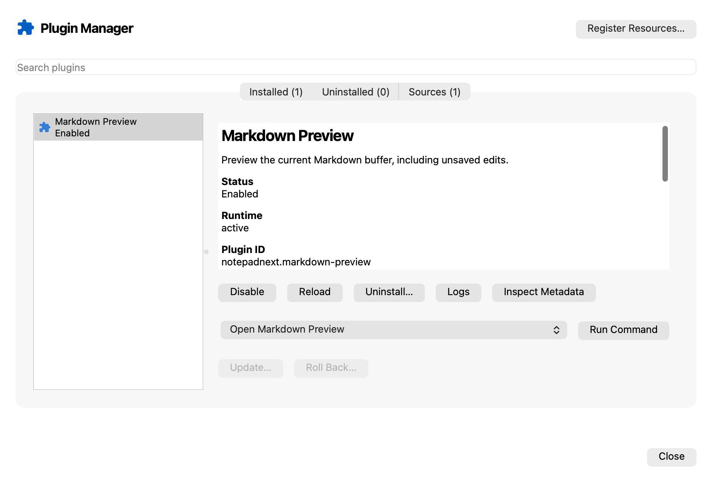

# 插件系统实施记录

## 当前开发阶段范围（2026-10-11 用户修订）

用户明确当前软件在开发中，不要求身份认证或发布。当前目标是本机编译、插件管理、Markdown／兼容样例、热插拔和功能验收。Developer ID、notarytool、正式签名、公证与发布移至以后，不阻塞开发；后续不继续调用本机正式身份或请求公证凭据。已完成的签名测试保留为历史资料。

已核查现有四个本机开发构建：正式签名身份参数都是默认 `-` 或未设置，公证 profile 为空。常规编译和测试没有认证依赖。此前把发行要求提前纳入当前完成门是工作范围偏移，现按用户指示纠正。

## 本机开发版试用入口（2026-10-11）

当前构建应用为项目目录下 `build/plugin-dev/NotepadNextPlusPlus.app`，Markdown 构建包为 `build/plugin-dev/markdown-preview`。这些文件是本机开发输出，不提交到 Git；应用使用本机 Qt SDK。打开应用，在 **Plugins → Plugin Manager… → Add Source…** 选择 **Local metadata file**，浏览到 `build/plugin-dev/markdown-preview/notepadnext-plugin.json` 并确认注册。在 **Discover** 选中 Markdown Preview，以蓝色 **Install Local Package…** 选择上述构建包并确认安装。转到 **Installed** 启用插件，以 **Open Markdown Preview** 打开预览。编辑器里未保存的 Markdown 会更新到面板。

2026-10-11 UI 修订：已对照 Figma 的注册列表、来源和生命周期详情重新实现管理器，保留系统深色主题对应的布局。Overview、Inspect 和 More 分离常用操作、可读详情及原始 metadata；打开命令时隐藏管理器并回到编辑器。首次 WebEngine 面板引起的原生窗口重建已复现并修复，见 [界面与窗口修复](UiWindowFix.zh-CN.md)。

2026-10-11 SDK 修订：新增独立开发包、hello/Markdown 模板、本地模拟宿主与 source-map 调试。模板携带 SDK，可离开主仓库使用；开发、锁定依赖、构建、测试、打包和真实编辑器安装的入口见 [SDK 开发说明](SDKDevelopment.zh-CN.md)。

注册、安装、启用仍由用户分步选择。菜单、图标、面板和热插拔均复用现有宿主；不需要申请 Developer ID 或发布仓库。实际 Production Application 集成测试现在从注册对话框和文件选择器进入这条路径，验证注册不安装、不启动，安装默认禁用，启用后渲染和退出清理。原始总计划仍记录更广的兼容语义与平台验收，不能用这一开发版交付替代全部完成审计。

2026-10-11：已接入资源注册、JSON-RPC/Node 宿主、真实 Scintilla 文档桥接、Qt WebEngine Markdown、本地／GitHub Release 安装与管理器运行入口。更新／回滚采用可恢复的原子索引事务；正常升级、坏升级、保留回滚历史与重启恢复已验证，首次激活延迟验证与激活暂存也已通过。文档 delta 与同步镜像已通过原生集成验证，见 [文档镜像契约](DocumentMirror.zh-CN.md)。Python 第二语言原型已接入同一服务，见 [Python 适配契约](PythonAdapter.zh-CN.md)。[有界 VS Code 核心与完整 HTML Webview](VSCodeCompatibility.zh-CN.md)已接入并验证；[有界状态与配置适配](VSCodePersistence.zh-CN.md)已支持单个持久编辑会话与全局状态；命名工作区、完整适配语义、进一步性能／故障验收和正式分发仍待完成。插件自己的配置与数据及卸载保留／删除已接入。数据规则见 [插件数据契约](PluginData.zh-CN.md)，使用中版本保护和卸载后的清理见[包回收与中断恢复](PackageCollection.zh-CN.md)。当前证据与未完成项见 `CompletionAudit.json`。

## 当前可用功能

从主窗口 **Plugins → Plugin Manager…** 打开管理器。Discover、Installed、Sources 分别显示注册资源、安装状态与注册来源。安装可以选择已经构建的本地包目录，或查看 GitHub Release 后显式选择发行 ZIP。

- 输入公共 GitHub 仓库 URL 和可选 ref，先检查根目录 `notepadnext-plugin.json`，再确认注册。
- 本机开发选择 Local metadata file，注册示例目录中的同名 JSON 文件；无需先发布 GitHub 仓库。注册后在 Discover 显式安装构建好的包，再在 Installed 启用和运行。Sources 可刷新本地文件，读取失败保留最后有效缓存。具体操作见 [Markdown 示例](../../examples/markdown-preview/README.md)。
- `list: false` 注册单插件；`list: [...]` 注册 Marketplace；空数组合法。两种来源都进入 Discover，不自动安装或启动。
- 搜索资源、查看详情和完整 metadata；手动刷新、检查与移除注册来源。
- 重复来源幂等更新；同一插件 ID、同一发行仓库合并来源关联。不同发行仓库的同名 ID 拒绝覆盖，需要先移除冲突来源。
- 刷新失败和取消保留最后有效记录。删除目录条目或移除一个来源只撤销该来源关系，其他来源提供的资源仍保留。
- 明确安装后先进入 Installed，默认禁用。启用后注册原生菜单／工具栏占位，点击时验证包完整性并延迟启动一个 Node 进程；Python 使用独立 Node relay 和 Python 子进程。禁用、重载、卸载会先撤销面板与订阅并停止旧进程。
- Installed 提供状态、metadata inspect、启用／禁用、重载、进程日志、Run Command 和卸载；来源仍列出资源时，卸载后返回 Discover。来源删除保留已安装包及其发行仓库信息。
- Sources 刷新成功并提供较新版本后，Installed 的 Update 入口可用；支持本地包和 GitHub Release。新版经过验证后保留一个上一版本供 Roll Back。当前更新需要有效来源提供新版 metadata；来源移除后先重新注册原仓库。
- 后台回收不再引用的包和中断安装的临时目录，保留当前／回滚版本及其他进程仍在使用的代码。卸载数据默认保留，确认时可显式选择删除。
- 注册记录保存于 `QStandardPaths::AppDataLocation/plugins/registered-sources.json`。应用拥有唯一 Registry，主窗口与管理器共享变化；重启后重新加载并验证缓存。

管理器采用通用拼图图标。尚未下载插件包时，条目使用宿主图标作为占位；本地安装器验证命令 PNG 图标后，运行入口在完整性复核通过后使用它；未声明图标的命令继续使用拼图占位。

## 代码职责与边界

| 路径 | 当前职责 |
| --- | --- |
| `src/plugins/sources/PluginMetadata.*` | 仓库 URL 规范化；使用随程序打包的统一 Schema 验证结构；验证 SemVer、ID 与命令归属、能力列表及来源一致性 |
| `src/plugins/sources/SourceEntryResolver.*` | 异步 GitHub 请求；先将 ref/default branch 固定到 commit，再获取该 commit 的 metadata；提供取消和总超时 |
| `src/plugins/sources/RegisteredResourceRegistry.*` | 资源与来源关系、共享来源合并、原子保存、缓存恢复及来源冲突检查 |
| `src/dialogs/PluginManagerDialog.*` | 原生 Qt 管理窗口、注册确认、列表、搜索、inspect、刷新与移除 |
| `src/plugins/packages/*` | SemVer 兼容性、目录／受限 ZIP 暂存、GitHub Release 查找／下载、SHA-256 内容目录、独立 Installed 索引与可恢复更新事务 |
| `src/plugins/rpc/*` / `packages/plugin-host/*` | 分帧、双向请求、预算／取消、独立 Node 进程与宿主 |
| `src/plugins/documents/*` | 真实编辑缓冲区身份、版本、快照、UTF-16 位置与编辑／单次 undo |
| `src/plugins/webviews/*` | 独立 WebEngine profile、本地 scheme、受控 XHTML／图片和消息 |
| `src/plugins/runtime/*` | 单插件激活会话、原生命令入口、完整性复核、停用／重载／退出清理 |
| `src/plugins/diagnostics/*` | 来源与会话绑定的受限队列、原子轮转快照、最近故障摘要和存储恢复 |
| `NotepadNextApplication` / `MainWindow` | 应用级服务所有权和 Plugins 菜单／工具栏接入 |

注册阶段仅访问 GitHub commit 和 contents API，不 clone 仓库、不读取发行包、不调用 npm、不启动插件进程，也不建立插件命令或面板。GitHub contents API 支持以 ref 读取文件；这里使用刚解析的 commit SHA，避免两次请求期间分支内容改变。[GitHub 官方文档](https://docs.github.com/en/rest/repos/contents?apiversion=2022-11-28)

metadata 限制为 1 MiB、JSON 深度 32、Marketplace 条目 500；单个网络响应最多 2 MiB，单请求无数据超时 15 秒，总查找期限 30 秒。最多 64 个来源，注册存储最多 8 MiB。不会跟随仓库重定向；仓库迁移后提示重新注册规范 URL。网络请求使用异步 QNetworkReply 信号。[Qt QNetworkRequest](https://doc.qt.io/qt-6/qnetworkrequest.html)

Schema evaluator 只支持仓库中当前 Schema 使用的关键字，不作为通用 JSON Schema 库发布。资源注册阶段的 `engines` 只检查字段结构；本地包安装进一步检查实际兼容性。范围 profile 支持完整 SemVer 版本、比较操作符、`^`、`~`、空白 AND、`||` OR 和 `*`；不支持的缩写会明确拒绝，避免误判。依据 [SemVer 2.0](https://semver.org/) 的优先级规则，并对齐 [npm node-semver](https://github.com/npm/node-semver) 的预发布匹配策略；不宣称实现全部 npm range 语法。

QSaveFile 提交成功后才替换内存状态。损坏缓存不会被新的注册操作覆盖；管理器显示错误并停止写入，原文件保留用于恢复。

## 验证与复现

本机 macOS arm64 / Qt 6.10.0 / Node 24.21.0：完整 NotepadNext 应用和关闭插件的应用编译成功。加入文档 delta 后的完整 17/17 CTest 通过（155.91 秒），含 Python、同步镜像、100 次 Markdown 生命周期与真实应用；见 `evidence/DocumentMirrorValidation.json`。诊断加入后的完整 14/14 CTest 通过（134.76 秒），包含资源、包／GitHub、父进程异常退出、双端 RPC、宿主、SDK、文档、数据、诊断、WebEngine 与实际应用目标；随后新增发行校验再验证受影响目标。历次基线、各轮源摘要和原始结果见 `evidence/ImplementationValidation.json`，完整范围及缺口以 `CompletionAudit.json` 为准。920×620 的真实 Qt 管理器渲染已检查。测试使用临时目录、统一 metadata fixtures 和模拟 GitHub 网络响应，不向用户的插件存储写入记录。

测试覆盖 URL 规范化、类型分流、非法与嵌套 metadata、大小/深度限制、幂等注册、共享来源、重启恢复、来源冲突、失败写入、刷新关联替换、损坏缓存保留、commit 固定、404、取消和响应超限，以及多个管理窗口共享列表与搜索。另经真实输入对话框与确认对话框验证单插件注册、Marketplace 注册、取消确认三个交互场景。

实际应用测试还覆盖窗口隐藏时打开文件、编辑、保存、磁盘重载、重命名、关闭最后标签、从插件菜单打开未保存 Markdown，以及关闭最后窗口后应用事件循环和插件退出屏障。关闭插件版本也通过同一编辑器操作／退出测试，二进制不链接 WebEngine。测试发现并修复了原 DockedEditor 对原生焦点事件的依赖：后台打开文件也会更新当前编辑器，关闭后的编辑器和已脱离容器的停靠区域不会被再次使用。GitHub 下载／安装使用受控模拟响应，尚无真实公开插件 Release 的端到端发布证据。



```sh
# 可独立验证资源模块与管理器，不需要构建编辑器的第三方依赖。
cmake -S tests/plugin-sources -B build-plugin-tests \
  -DCMAKE_PREFIX_PATH=/path/to/Qt/6.10.0/macos
cmake --build build-plugin-tests --parallel
ctest --test-dir build-plugin-tests --output-on-failure

# 完整应用构建时启用同一测试。
cmake -S . -B build \
  -DCMAKE_PREFIX_PATH=/path/to/Qt/6.10.0/macos \
  -DNOTEPADNEXT_PLUGINS=ON \
  -DNOTEPADNEXT_PLUGIN_WEBVIEWS=ON \
  -DNOTEPADNEXT_PLUGIN_NODE=/absolute/path/to/verified/node24 \
  -DNOTEPADNEXT_TEST_NODE=/absolute/path/to/verified/node24 \
  -DNOTEPADNEXT_BUILD_PLUGIN_TESTS=ON
cmake --build build --parallel
ctest --test-dir build --output-on-failure

# 测试预览器仅展示临时示例资源；不注册到真实应用存储。
build-plugin-tests/PluginManagerPreview
```

本机 Qt SDK 和构建输出在 `/private/tmp/notepadnext-qt/6.10.0/macos`、`/private/tmp/notepadnext-app-build-610` 与 `/private/tmp/notepadnext-plugin-tests-610`，没有安装系统 Qt。Qt 6.8.3 在当前 Xcode 的链接步骤因缺少 AGL 框架失败，最终验证采用 CI 已支持的 Qt 6.10。Windows/Linux、干净系统打包、真实插件仓库端到端注册、键盘完整导航与性能预算仍待验证。

默认开启核心插件模块、关闭 WebEngine，避免基础构建新增浏览器依赖。Markdown 示例需要显式开启 `NOTEPADNEXT_PLUGIN_WEBVIEWS` 并提供 WebEngine／WebChannel SDK；关闭预览能力的构建会拒绝需要 `webviews@1` 的包。`NOTEPADNEXT_PLUGINS=OFF` 关闭生产应用的插件服务与入口。

## 运行与本地包边界

`packages/plugin-sdk/pack.cjs` 从已经构建的 TS 示例生成本地发行目录，携带生产依赖、嵌套依赖版本及许可证，不执行插件或 hooks。开发依赖不进入发行目录。`archive.cjs` 将该目录生成安装器接受的 UTF-8 ZIP 并输出 SHA-256；真实 Markdown 的目录与 ZIP 安装会核对同一内容摘要。

安装任务在工作线程中复制并验证：最多 256 MiB、单文件 32 MiB、8192 个目录／文件条目、目录深度 32；拒绝 symlink、非普通文件、路径越界、平台路径别名和原生 `.node` addon。包 metadata 必须与当前注册条目一致，入口与 LICENSE 是实际文件，PNG 图标最多 1 MiB／512×512，必需能力必须可用。暂存包验证完成后按内容摘要原子发布，Installed JSON 索引原子提交；取消和失败不改 Installed 状态。索引写入还检查其他进程的修改；损坏索引保留原文件并停止写入。发布后取消留下的未引用完整包由后台回收处理；使用中的版本与尚未提交的包持有跨进程 lease。详细规则见[包回收与中断恢复](PackageCollection.zh-CN.md)。

ZIP 压缩包最多 128 MiB；只接受 Stored／Deflate、单卷、非加密、非 ZIP64 的明确 profile。目录与本地头、条目名称、大小、CRC 和数据描述符必须一致；拒绝隐藏前缀、尾随数据、路径／大小写／Unicode 别名、链接、特殊文件、条目重叠、未知 extra 字段与超出预算的解压数据。时间戳等有限无执行作用的 extra 字段可接受。解包在私有目录执行，随后复用目录包检查；SDK archive 工具生成这一 profile。

GitHub 查找仅接受当前目录 metadata 的稳定版本，最多 500 个 Release、64 个候选；优先选择当前平台／架构 asset，其次 universal `notepadnext-plugin.zip`，由用户选择。下载使用仓库与 asset ID 构造 API URL，不采用任意 browser_download_url。只允许明确的 GitHub HTTPS asset 重定向，每阶段最多 5 次；限制 ZIP 128 MiB、校验文件 64 KiB、15 秒无数据期限、120 秒总期限。优先核对 GitHub 提供的 SHA-256，缺少时验证同 Release 的作者校验文件；无两者的资产不进入候选列表。ZIP CRC 与安装包完整性也继续检查。查找不会下载或安装；取消、网络或验证失败删除临时文件。首版不支持私有仓库／认证。

启动前再次在工作线程复核包内容。stdout 只用于 JSON-RPC，stderr 有速率预算，管理器日志有 32 KiB 上限；具体传输契约见 `ProtocolProfile.zh-CN.md`。普通 Node 进程拥有当前用户的操作系统权限，能力列表仅控制宿主 API。

应用仅使用自身目录中的 Node 和宿主脚本，不查找 PATH。构建时传 `-DNOTEPADNEXT_PLUGIN_NODE=/absolute/path/to/verified/node`；CMake 检查锁定版本并将二进制、宿主和 Node LICENSE 复制到应用目录。供应者仍需先按 `runtime-lock.json` 验证原始发行档案。macOS 位置是 `Contents/Helpers/nnp-node` 和 `Contents/Resources/plugin-host`；未配置 Node 时可以管理资源，激活会显示缺失运行时的错误。

关闭窗口先撤销运行资源；最终退出保留事件投递以等待工作线程和进程结束，5 秒强制清理、8 秒总退出期限。真实应用的正常退出已通过测试；最外层期限和阻塞文件系统等极端情况仍需故障证明。退出还取消待运行的包回收，并等待已开始的清理线程。未引用包回收与显式数据删除已经接入；正式部署仍未完成。

## 更新与回滚事务

准备新版包期间不改变安装索引和旧会话。提交前检查安装摘要仍与准备时相同，阻止其他窗口／进程或卸载竞态覆盖。旧会话与验证任务结束后，单次原子索引提交同时保存候选、原启用状态、上一版本和待确认标记。运行时复核候选包并完成 initialize／activate，要求所有声明命令均已注册；验证通过后才清除待确认标记。禁用或尚未激活的插件只提交静态检查通过的新版，保留旧版和“首次激活待验证”标记；更新不启动其进程。首次使用前，将标记原子转换为正在验证，失败恢复旧版。

候选验证失败，先停止候选，再原子恢复旧版；启用插件重新启动旧会话。上一版本的既有回滚历史在失败或中断时保留。重启读取到执行中但未确认的事务时，先恢复旧版并持久化，再发布菜单或启动插件；明确延期到首次使用的版本保留安装状态。Roll Back 复用相同停止／验证／确认路径；不允许普通 Update 隐式降级或更换发行仓库。激活资源先暂存：读取和资源登记允许在 Activating 执行，文档写入被拒绝；面板保持隐藏，激活失败则撤销。更新验证还将命令调用和面板发布保留到索引确认之后。

激活成功只证明当次激活，不能保证未来插件代码不崩溃；Active 会话每 10 秒发送健康 ping，2 秒无有效响应即撤销资源并终止进程。已激活会话崩溃后按 1/2/4 秒退避，60 秒内最多自动重启三次；启动或激活失败不自动循环重试。禁用、重载、更新或退出撤销排队的重启。

## 当前验证与下一阶段

JSON-RPC 两端共享 fixtures、真实缓冲区 Unicode／版本／undo、sandbox 开启的 WebEngine scheme／消息／大页面和 Qt→Node→TS 的未保存 Markdown 预览均已有自动化证据。完整开启 WebEngine 和关闭插件的应用构建已通过；关闭版本未链接 WebEngine。包事务和真实管理器生命周期正在追加验证，最新结果见审计台账。

真实 Markdown 已通过 100 次启用／打开／重载／再打开／禁用，200 个激活会话，每轮面板、订阅、会话和入口回到基线；本机总循环约 37–38 秒。无响应 Node 的健康超时、一次崩溃成功恢复、持续崩溃触发三次限额和禁用取消重启也通过。该证据不等同 RSS、句柄或其他平台泄漏验收。

共享 wire schemas、配置／存储、数据删除、包回收、持久诊断和 Python 适配已接入。后续补全更新故障、平台压力和真实公开 Release 证据；验证固定范围的 VS Code API 及正式跨平台打包。各项完成须有对应证据。

## 插件数据验证

加入 storage/configuration 两项独立能力后，以固定静态 zlib 1.3.2 再次执行完整 11 个 CTest 目标，11/11 通过（90.03 秒）。含真实 Node/SDK 插件数据持久化、激活写入拒绝、重载、保留数据卸载后重新安装、删除数据后重新安装，以及 100 次 Markdown 生命周期循环。原始日志为 `evidence/plugin-data-conformance.log`。随后加入共享业务 Schema、SDK 删除编码修正、数据队列公平调度和原生卸载确认，完整 12/12 CTest 再次通过（86.42 秒）；关闭插件的应用回归测试也通过（0.38 秒）。当前完整日志为 `evidence/wire-data-conformance.log`。

## 业务协议验证

当前 24 个方法的参数／结果采用共享 JSON Schema 2020-12 定义，Qt 编译内置和随应用分发的 Node 宿主执行同一契约。118 个共享 fixtures 在两端通过；独立 Draft202012Validator 检查通过。版本协商、能力、状态、错误、取消与预算见 [业务协议契约](WireContract.zh-CN.md)。SDK 的 undefined 删除 key 已用真实数据生命周期回归验证。构建同时将 JS／Schema 资源列为链接依赖，单独修改宿主也会刷新 app 中的副本。

## 数据来源隔离与 codegraph

最后将数据命名空间绑定为插件 ID 与安装来源仓库的组合。同 ID 的其他仓库读取不到保留数据，复制到错误命名空间的记录被保留并返回 DataUnavailable。激活中写入拒绝、待确认更新命令的写入发布屏障、数据／WebEngine／实际应用的三个受影响目标全部通过（70.10 秒）。这一轮之前的 12/12 完整基线与 3/3 受影响目标验证组合记录在 `evidence/ImplementationValidation.json`；这不覆盖审计中仍列为 partial/pending 的交付项。

Code Review Graph 2.3.9 的默认 Git 文件扫描遗漏未跟踪源文件。`scripts/update-codegraph.py` 在同一 MCP Python 环境中补充非忽略的未跟踪文件，再使用原解析和后处理流程；不改变 Git 暂存区或安装的工具代码。数据、协议、进程身份、CommonJS 宿主和诊断模块已通过 MCP 实际查询确认进入图。最新文件／节点数量见 `evidence/working-codegraph-build.log`。未提交这些源文件前，应使用该脚本刷新；默认 full rebuild 会遗漏它们。

## 包回收验证

跨进程使用记录、候选／回滚版本保留、失效下载进程、分批回收、损坏索引与不安全目录保留已实现。压力测试暴露的清理／停用抢锁竞态已通过调整 lease 与原子索引的观察顺序解决；正常启停无需等待清理锁。最终完整 12/12 CTest 通过（84.66 秒），包含 47 个包测试用例与 100 次真实 Markdown 生命周期（36.92 秒）；原生管理器卸载后包目录被回收。日志为 `evidence/package-gc-conformance.log`。关闭插件的编辑器／退出验证也通过，见 `evidence/gc-disabled-editor-summary.log`。

这一轮完整回归中曾出现一次实际主窗口预览未显示预期标题，单独重跑通过。增加页面／当前文档诊断、异步结果独立所有权和失败清理之后，连续十次实际应用测试通过（10.69 秒），随后最终完整回归通过。原失败保留在 `evidence/gc-preview-intermittent-failure.log`；原因仍未确认，继续列入 Markdown 故障验收，不能据此宣称所有竞态已解决。

## 父应用异常退出验证

实际运行记录现在保存 PID、平台和启动时间；父应用锁失效后，仍存活的 helper 继续保护代码目录，PID 复用不会错误地保留旧进程身份。Unix 专用管道由独立 Node worker 异步监听，父应用消失时可终止主线程卡死的插件与同组子进程。macOS 的实际 SIGKILL 父应用／暂停并恢复 spinning helper／代码目录保留与最终回收均通过；Windows Job 与其他平台仍待执行验证。规则见[父应用退出与插件进程所有权](ProcessSupervision.zh-CN.md)。

加入此故障目标后完整 13/13 CTest 通过（124.65 秒），日志为 `evidence/parent-supervision-conformance.log`。100 次生命周期循环本次 62.18 秒，较之前 36.92 秒增加；新增 worker 的独立资源成本和完整预算尚须测量。初版阻塞读取曾拖住正常 shutdown，已替换为异步监听；正常 shutdown、EOF 和非法 fd 的 7 个 Node host 用例全部通过，原失败保留在 `evidence/parent-watch-blocking-shutdown-failure.log`。

CodeGraph 刷新入口同时补充 `.cjs` 的 JavaScript 解析映射；之前默认解析器漏掉没有 shebang 的 CommonJS 文件。已通过 MCP 实际查询确认 `parent-watch.cjs` 与 `ProcessIdentity.cpp` 均在图中。该扩展仅作用于一次刷新进程，不改安装的工具或 Git 索引。

## 持久化诊断

来源与会话绑定的轮转快照、最近故障摘要、命令耗时和退出码已经接入，管理器详情与 Logs 提供分类和历史记录。真实激活／协议／包故障测试发现并修复了关闭排队命令覆盖原始故障摘要的问题。超大错误显示受限，失败进程仍在退出时的立即重试会等待清理后重新激活。完整 14/14 回归通过（134.76 秒），100 次生命周期循环 76.45 秒；关闭插件的实际编辑器／退出单目标也通过（0.29 秒）。具体预算、恢复和验证见[插件诊断与故障分类](Diagnostics.zh-CN.md)。首次 disabled 验证误选了未编译的独立插件目标，原选择错误保存在 `evidence/diagnostics-disabled-selection-error.log`，不作为编辑器失败或通过的证据。

## 插件发行校验与作者工具

GitHub 下载优先验证 Release asset 的 `sha256:` digest。缺少时必须存在同一 Release 的 `notepadnext-plugin-checksums.json`，根据已检查的 asset ID 读取；检查插件／版本、封闭结构、名称、大小、SHA-256 和重定向后才下载包。无校验的资产不会进入选择列表。完成安装记录校验来源及作者校验 asset ID；更新复用同一路径，注册仍只读取 metadata。受影响的来源、GitHub 安装和实际应用三个目标通过（2.88 秒），含 39 个 GitHub QtTest 用例；网络仍为模拟，真实公开 Release 验收尚未完成。

`packages/plugin-sdk/release.cjs` 从构建好的代码生成 ZIP 和校验文件，并核对 stable tag／包版本；不执行插件或 hooks。7 项 SDK 测试通过，实际 Markdown 发行 ZIP 经原生安装器再验证通过；独立作者目录中的 locked install、TS build/test 和发行生成已实际复现。可复制的发行 CI 在 `templates/github-release.yml`，默认创建草稿。完整契约和独立仓库准备步骤见[插件作者发行流程](AuthorRelease.zh-CN.md)。本地工具测试与发布到 GitHub 是不同证据；目前未执行远程工作流或发布实际仓库。

## Python 第二语言验收

Python 3.12 原型使用统一 metadata 和原有 JSON-RPC 服务，受控 Node relay 转发帧并独立监督解释器，首次 activate 才导入入口。应用资源包含适配脚本；解释器由开发者通过绝对 CMake 路径配置，尚未随包分发。API、XHTML 片段要求、UTF-16 位置、stdout 隔离和预算见 [Python 适配契约](PythonAdapter.zh-CN.md)。[Buffer Inspector 示例](../../examples/python-inspector/README.md)打开未保存文本；发布工具已支持 Python，并实际生成 13,867 字节的 ZIP 和相应 SHA-256 校验文件。

共享 28 项 RPC 与 118 项业务 fixtures、追加边界／句柄测试合计 152 项 Python 测试通过；4 项真实 stdio 宿主测试和 9 项 SDK 包／发行测试通过。真实管理器同时运行 JS 和 Python，确认读取相同未保存 Unicode／CRLF 文本，独立重载卡死的 Python，确认旧解释器退出、JS 会话身份不变、新会话读取修改后的缓冲区。父应用被 SIGKILL 时，relay、Python 和同组子进程全部退出；运行中的代码目录先保留，退出后回收。生产应用包内宿主及面板／卸载也通过。

本轮完整 16/16 CTest 通过（147.99 秒），WebEngine 19 项和实际应用 5 项均通过，100 次 Markdown 生命周期 79.341 秒。关闭插件的实际编辑器单目标通过（0.53 秒）；其中 Python 测试分支已编译移除，不能作为 Python 激活证据。完整套件包含 IPC 测量且期间重建了 disabled 应用，该时间不用于隔离性能验收。原始结果和 88 项源摘要见 `evidence/PythonAdapterValidation.json`、`evidence/PythonSourceSha256.json` 和 `evidence/python-full-conformance.log`。

首轮示例错误地发送完整 html/body 外壳，已改为受限 XHTML 片段；重载断言曾在异步存储更新前读取旧 PID，已改为等待新值。macOS 还曾将直接调用的单项测试名当作打开文件请求，该次运行被停止后改用无位置参数的 CTest，生产和完整回归随后通过。原日志均保留。I3 的第二语言本机验收已完成；VS Code 适配、完整资源／性能与故障矩阵、真实远程发行以及可搬移、签名和公证的正式分发仍在原计划范围内。

## VS Code 完整 HTML Webview 增量

同步 `createWebviewPanel` 代理已接入，按创建确认顺序发布 URI、title/html 和消息；创建尚未确认就 dispose、正常关闭撞上已发出的更新，均只回收所属面板。兼容页面使用单独的 `webviews.compat@1`，还须授予 `webviews@1`。完整 HTML、本地 UTF-8 JS/CSS/图片、Qt 响应头 CSP、当前 revision 的消息/state 桥，以及实际焦点/可见性通知已有测试。能力要求 Qt WebEngine 6.6+；本机验证版本为 6.10.0，未据此声明所有旧版组合通过。

[Cat Coding 样例](../../examples/vscode-webview/README.md)固定到官方 MIT 提交，保留精确上游源及哈希，浏览器 JS/CSS 不变。移植删除未支持的 serializer，并将远程 GIF 换成本地 PNG fixture；fixture 的 GPL 通知随 media 导入，包记录混合许可证。实际安装后禁用、菜单惰性激活、隐藏 DOM 中的计数器和双向消息、关闭重开、重载、停用和卸载均已验证。HelloWorld 的未修改命令样例仍保留。

本轮完整 **21/21 CTest 通过（182.97 秒）**；最终补齐 fixture 通知后，样例编译/来源哈希、导入器/核心与生产应用的 **3/3 受影响目标通过（4.37 秒）**。关闭插件的编辑器验证 **1/1 通过（0.44 秒）**。33 个业务方法和 174 个 fixtures 由独立 Draft 2020-12 求值器复核；Python 209 项和 Webview 代理/浏览器桥 10 项通过。两个实际 bundle 的 19 个宿主文件与当前源码哈希一致。

测试发现并修正了 lazy UTF-8 解码未触发错误检查、正常关闭被误判为插件故障、焦点连接捕获已销毁服务，以及临时/旧页面收到新桥脚本的问题。OS 崩溃帧及失败日志随证据保留；焦点连接现在绑定服务并在面板关闭时解除，桥按实际 URL revision 初始化并在同一上下文复用 transport。当前完整 CTest 的目标摘要保留；完整 `LastTest.log` 在受影响测试时轮转，因此没有推测逐项总数或单独循环耗时。证据入口为 [VSCodeWebviewValidation.json](evidence/VSCodeWebviewValidation.json)。完整原方案仍为 9 项 complete、16 项 partial、2 项 pending；Context 持久化、完整故障/性能、远程 CI/Release 和签名分发继续保留。

## 有界 VS Code 状态与配置验证（2026-10-11）

同步 globalState／单编辑会话 workspaceState 和私有声明配置已接入，见 [语义与限制](VSCodePersistence.zh-CN.md)。新增原生条件写入在同一锁内检查 expectedValue；竞争重读只重应用当前键，磁盘错误不污染后续队列。激活和更新验证阶段仍禁止写入，损坏记录保留。导入器新增显式 --storage／--configuration，拒绝不能执行的配置 Schema。

完整 **21/21 CTest 通过（177.95 秒）**，保留完整原始输出。最终对象枚举语义与 Python SDK 增补后，**4/4 受影响目标通过（4.26 秒）**；最终真实 Qt 持久化／原生数据／激活发布检查 **5/5 通过（含 setup/cleanup，7482 ms）**，原生数据 Store **8/8 通过（含 setup/cleanup）**，Node 核心与 wire **206 项**及 Python **216 项**通过。33 方法／180 fixtures 独立 Draft 2020-12 复核；两个实际 bundle 的 **20 个宿主文件**与最终源码一致。Native 完整目标 149.33 秒是整个目标时间，不代表单个生命周期或性能预算。

证据见 [本轮记录](evidence/VSCodePersistenceValidation.json)。完整计划继续保留：命名／多根 workspace、激活写入、完整配置与迁移、进一步故障／性能验收、签名／公证／可迁移分发和跨平台矩阵尚未完成。审计状态继续 in_progress。

## macOS 部署与开发介质（2026-10-11）

Node 插件版现在有独立 Release 打包入口，校验官方 Node 档案与原始二进制、复制部署 Qt、逐个检查 Mach-O 与资源、由内到外签名并生成 DMG。修正了应用版本和最低系统字段；控制 Node 构建下限为 macOS 13.5。部署探针发现定位插件遗漏 QtSerialPort，依赖检查保留了失败并在补齐 SDK 模块后通过。默认开发签名的主程序添加其所需库验证例外；正式身份不添加该例外，Node 与 WebEngine helper 使用各自 JIT profile。

本机 Release 的原有 19 个 CTest 目标通过；新增打包目标中的 14 个正反用例通过。复制到空格／中文路径的集成应用运行编辑器、管理器、TS Markdown、VS Code 命令与 Webview，加载的 20 个 Qt 映像和运行时位于复制包内。生产 DMG 完成校验、只读挂载、复制与卸载，复制后的生产程序版本命令通过；插件关闭和保留 Python 的开发应用也重新通过集成测试。搬移用的是包含生产 Application 源码的集成测试应用，仍有外部 author fixtures，不作为干净机器证明。

证据见 [MacOSDeploymentValidation.json](evidence/MacOSDeploymentValidation.json)，操作见 [macOS 部署](MacOSDeployment.zh-CN.md) 和 [平台矩阵](PlatformCapabilities.zh-CN.md)。本机没有 Developer ID Application 身份，正式签名／公证分支未执行；Intel、实际最低系统、干净系统和完整 notices／源码义务仍待验收。完整计划保留，审计继续 in_progress。

## 真实预览性能与后续签名验证（2026-10-11）

生产 JSON-RPC HTML 发布现在由最多四个后台线程清洗 XHTML、构造 CSP 页面和编码 UTF-8；每个面板只接受一个待处理任务，忙时返回 1007。GUI 发布前重新检查文档身份、版本、当前活动文档和面板序列；关闭面板或服务会取消准备，任务只持有值副本。Markdown 对忙状态重新合并刷新，防抖调整为 150ms，最大等待仍为 800ms。原有脚本／资源限制继续执行。Qt Core 的 [QPromise](https://doc.qt.io/qt-6/qpromise.html) 提供跨线程结果传递，无需新增 Qt Concurrent 依赖。

原生受限页面对屏幕外段落、列表等应用延迟布局；真实测试确认可以滚动到全文尾部并搜索全部 4,000 个段落。页面仍生成完整的清洗内容，当前端点检查最新标题经过两次 animation frame 后的原生消息，不直接测量显示器像素。屏幕外布局语义依据 [CSS Containment](https://www.w3.org/TR/css-contain-2/#content-visibility)。

在 Apple M4 Max、16 核、64GiB、本机 macOS 27.0.1／Qt 6.10.0 Release 上，单实例性能目标通过。1／5／10 个独立 Markdown 插件的 100KiB 最新全部面板 p95 分别为 **315／316／350ms**；九组大小／数量组合中的最大 GUI dispatch 为 **26.4ms**，停用资源撤销最大 **78.7ms**，原定 500／50／3000ms 预算未放宽。10KiB 和 1MiB 的原始样本、进程 CPU／RSS、文件描述符及十秒空闲流量均已记录。CPU 原始量按 Mach timebase 转换，并以 PID 和原生创建时间匹配；依据 [Apple XNU 的 taskinfo 实现](https://raw.githubusercontent.com/apple-oss-distributions/xnu/main/osfmk/kern/bsd_kern.c) 和 [recount 单位](https://raw.githubusercontent.com/apple-oss-distributions/xnu/main/osfmk/kern/recount.h)。RSS 是工作结束后的逐进程快照，不是峰值或去重后的物理内存总量。密集 1MiB 文档的全部面板 p95 仍为 1.98–3.25 秒，十实例聚合 RSS 约 15.9GiB，保留为后续优化依据。

完整 Node Release **20／20 CTest 通过（169.99 秒）**；新增 DMG 签名正例后的 macOS 打包目标 **15 个用例通过**，Python 开发编辑器目标重新通过。100 次启用／打开／重载／停用循环确认 **200 个 Node 进程身份退出**、每次会话／面板／资源回到零、焦点连接为零，原生文件描述符从初始 30、预热 32 回到 32；RSS 不要求精确回到分配器基线。完整测量与限定见 [MarkdownPerformanceValidation.json](evidence/MarkdownPerformanceValidation.json)。早先两轮受额外测试进程干扰，保留诊断数据并明确排除验收；验收运行使用独占测量锁，没有并行构建、其他测试或 UI 检查。

本机钥匙串后续提供了有效 Developer ID 身份：正式签名应用与 DMG、所有 Mach-O 的共同 Team／安全时间戳，以及搬移后的签名集成运行均通过。当前等待 notarytool profile 名称，公证未提交，Gatekeeper 返回 `Unnotarized Developer ID`。原 P0／I1／I2／I3／I4 的 27 项要求均保留；完整发行、跨平台与其他 partial 项仍未完成。

## 原生主题字体与安装竞争验证（2026-10-11）

原生预览现使用主窗口的颜色和阅读字体，代码区使用当前 Scintilla 编辑器的默认字体及字号。切换文档、修改字体或调色板会更新受信任的 nonce 样式，不重载页面；真实 DOM 测试确认 URL、滚动位置、面板和文档版本保留。字体名称按 CSS 字符串及 HTML style 文本边界转义；同步页面、异步准备期间修改外观、恶意字体名称和实际应用设置均通过。逻辑像素与点的转换遵循 [QFont](https://doc.qt.io/qt-6.10/qfont.html)；宿主在 [ApplicationWorld](https://doc.qt.io/qt-6.10/qwebenginescript.html) 更新 DOM，不增加插件 RPC 能力。

真实 TS Markdown 测试补齐 Unicode 标题、列表、代码、相对 Unicode 图片、缺失／远程图片的可读状态，以及非 Markdown、非法 UTF-8、超限、关闭和恢复。磁盘中保存的内容与未保存缓冲区故意不同，确认预览使用编辑器快照。既有旧结果拒绝、关闭重开、连续点击和清理测试仍在完整套件中；原第一交付要求的主题字体已具备本机行为证据。

完整回归发现后台包回收短暂持有发布锁时，立即重新安装可能失败。安装工作线程现在最多等待 1000ms，每 10ms 检查取消；GUI 上原有 lease 调用保持非阻塞，也不移除仍被持有的锁。释放后成功、持锁取消、持锁超时三项真实安装测试确认 GUI 定时器持续运行；兼容插件持久化生命周期随后连续五次通过。锁规则依据 [QLockFile](https://doc.qt.io/qt-6.10/qlockfile.html)。

当前源码的 Node-only Release 完整 **20／20 CTest 通过（191.70 秒）**，其中 Webview 41 项通过、2 项 Python 跳过，应用 7 项通过、1 项 Python 跳过。另行重新编译的 Python 开发配置应用测试 **8 项通过、无跳过（CTest 4.05 秒）**；插件关闭配置应用测试 **8 项通过（0.35 秒）**。100 次真实生命周期循环耗时 87.082 秒，200 个 Node 身份退出，每次资源／会话／焦点连接为零，文件描述符初始 30、预热和最终均为 32。失败的临时 JSON 代理引用、图片 fixture 和实际安装抢锁记录均保留，最终验收使用修正后的完整通过记录。

构建、回归及 codegraph 完成后，独立性能目标 **通过（118.79 秒）**：1／5／10 插件的 100KiB 最新全部面板 p95 为 **315.4／315.9／349.0ms**，九组组合最大 GUI dispatch **15.9ms**，资源撤销最长 **77.7ms**；原预算未改变。密集 1MiB 仍为 1.88–2.23 秒，十实例工作结束后进程 RSS 合计约 16.49GiB，不能视为峰值或去重物理内存。各角色 CPU、空闲流量和逐进程数据保留；不据两个运行的差异推断性能改善。

当前版本重新生成 Developer ID 签名应用与 DMG，36 个生产 Mach-O 同 Team／安全时间戳、DMG 校验及挂载复制、搬移后的 Node JIT 和生产源码应用测试均通过。搬移测试加载的 20 个 Qt 映像与 Node／宿主路径全部位于复制包内；仍使用外部作者 fixtures，不等同干净机器验收。用户已确认本机公证 profile **尚未配置**，未提交公证；后续本地配置命令见 [macOS 部署](MacOSDeployment.zh-CN.md)。

当前证据入口为 [NativeAppearanceValidation.json](evidence/NativeAppearanceValidation.json)，源码摘要覆盖 188 个输入，codegraph 覆盖 1015 文件、22114 节点、115841 边。审计保留全部 27 项，原参考性能记录和 Markdown 第一交付两项完成，合计 **11 complete／16 partial**，整体仍为 `in_progress`。正式公证、干净系统、其他平台、完整许可源码义务及其他故障要求继续保留。

## 安装更新的真实进程中断验收（2026-10-11）

新增原生子进程 fixture，在生产复制回调中的部分文件、不可变包发布后、安装索引提交后，以及更新／延期验证／确认／回滚各阶段强制结束进程。九个阶段组合启用／禁用状态共 15 个数据场景通过；恢复和重复恢复各自在新进程执行，回收后再由第三个进程校验当前及所有历史版本。延期验证保留三个版本，开始验证后中断会恢复原当前版本和历史；恢复锁占用时索引不变、写入被拒绝，释放后可恢复。未执行插件代码，PID 加原生创建时间的 15 个事务进程身份均已确认退出。

包相关 **3／3 CTest 通过（6.02 秒）**：包测试 48 项、中断测试 17 项、GitHub 事务 42 项，均含初始化／清理。范围和阶段表见 [事务恢复说明](TransactionRecovery.zh-CN.md)，原始证据见 [TransactionRecoveryValidation.json](evidence/TransactionRecoveryValidation.json)。这证明指定阶段的进程中断，不替代断电、磁盘已满、系统调用内部故障、GUI／退出竞态或其他平台证据。

该增量只新增两个测试文件与测试 CMake 接线，生产输入与上一轮签名包一致；没有重新生成安装包或重复无关性能测量。当前源码摘要覆盖 190 个输入；codegraph 已刷新并实际查询确认两个新文件进入图，覆盖 1017 文件、22131 节点、116206 边。原 27 项及整体 `in_progress` 状态保留，相关 I1／I2 项新增具体证据，未据包级测试宣称整个交付完成。

## 生产应用退出与排队操作验证（2026-10-11）

独立外层测试启动包含生产 Application/MainWindow/插件服务的集成应用，使用真实菜单激活、storage 写入、文档 watch 和原生面板。正常退出、deactivate 主线程死循环、重载排队、删除数据卸载排队及候选激活中退出五场景均通过。12 个 Node／同组子进程身份在 exec 返回时已退出，资源／会话为零；未提交的卸载保留安装与数据，重载未再次激活，未确认候选面板保持隐藏并在后续索引加载时恢复原版本。

该轮 Release **2／2 应用相关 CTest 通过（16.50 秒）**，最大退出耗时 2504ms，原 8 秒期限未改变。重新编译的 Python 开发和插件关闭应用分别 **8 项通过（3.72／0.41 秒）**。原误用 updating／activating 层次的测试失败保留，修正后完整通过；同时修正文档中已经接入的 Memento 仍被描述为未实现的旧状态。

阶段表和复现命令见 [应用退出说明](ApplicationExit.zh-CN.md)，原始结果见 [ApplicationExitValidation.json](evidence/ApplicationExitValidation.json)。本轮只改测试及接线，生产签名包输入未变；193 个源码输入摘要已保存，codegraph 实际查询确认三个新文件进入图，当前 1020 文件、22147 节点、116560 边。全部 27 项保留，整体继续 in_progress；阻塞文件系统／工作线程和外层 5／8 秒兜底触发，以及正式发行和其他平台缺口未关闭。

## 更新准备期间的应用退出（2026-10-11）

补充第六个真实应用退出场景：更新请求在实际包存储锁被持有时保持准备中；最后主窗口关闭后，准备被取消，installer 完成收尾，原安装版本、启用状态和数据保留，激活历史没有新会话。锁直到 exec 返回仍被持有。当前六场景和原有应用测试 2／2 CTest 通过（18.71 秒），14 个 Node／子进程身份全部退出；最大退出耗时 2563ms，保留原有 8 秒期限。见 [验收记录](evidence/ApplicationPreparationExitValidation.json)与[退出说明](ApplicationExit.zh-CN.md)。

此次只修改两个退出测试源文件，193 个已有输入重新记录 SHA-256；生产输入与前一轮正式签名包一致。首次等待谓词误报及诊断结果保留。当前证据覆盖可取消锁竞争；不可中断文件系统、外层退出兜底、其他平台、公证及完整许可证／源码审核仍保留在原审计中。
