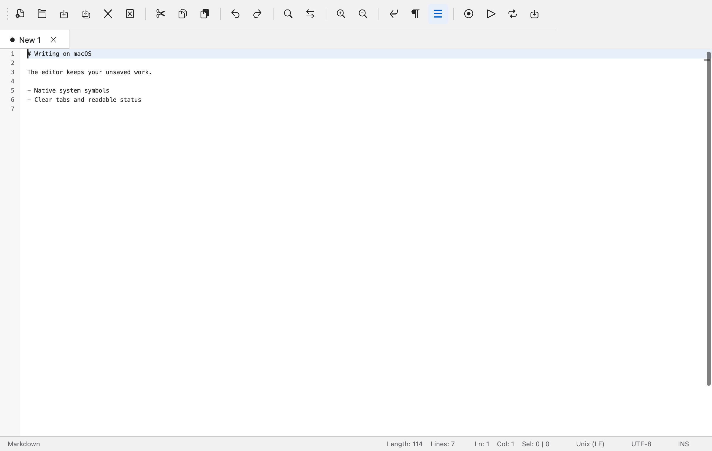
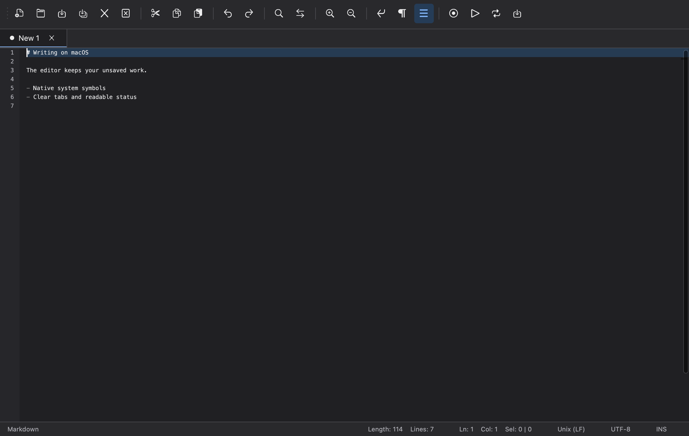
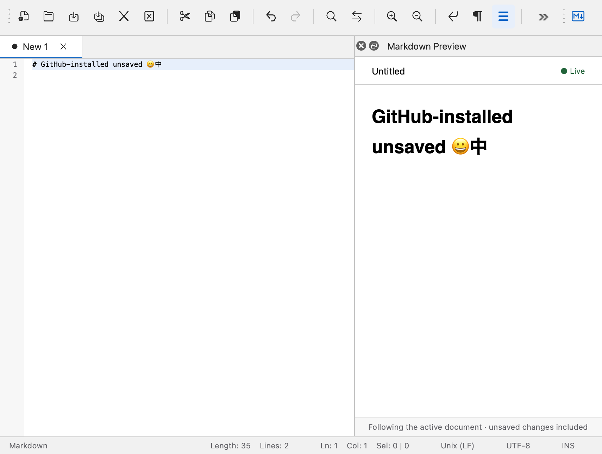

# 独立 Markdown 仓库与 macOS 界面

2026-10-12，本机 macOS arm64、Qt 6.10.0、Node 24.21.0。

## 注册、安装与更新

公开仓库：[KMerdan/notepadnext-markdown-preview](https://github.com/KMerdan/notepadnext-markdown-preview)。这是用 SDK 0.1.0 创建的独立 TypeScript 项目，携带 SDK、锁定的依赖、source maps、VS Code 调试配置、行为测试和开发文档。构建插件不依赖 NotepadNext 源码或 Qt。插件 ID 为 `kmerdan.markdown-preview`，与原来的本地样例 `notepadnext.markdown-preview` 分开。

1. 在 **Plugins → Plugin Manager… → Register Resources…** 输入仓库 URL；检查并注册后，资源进入 **Uninstalled**。
2. 选择 **Markdown Preview → Install…**，选择稳定版本安装包，确认安装。
3. 在 **Installed** 中启用插件，选择 **Open Markdown Preview**；编辑 `.md` 文档，或将新文档语言设为 Markdown。
4. 更新时，在 **Sources** 刷新这个来源，再到 **Installed → Update…** 选择较新的 Release。启用状态和设置保留；More 中的 Reload 重启安装版本，Roll Back 使用保留的上一版本。

如果原本的本地样例也已启用，先停用那个样例，避免两个 Markdown 命令同时出现。

GitHub Actions 已在真实公开仓库完成 locked install、构建、测试、SDK 打包和 Release ZIP/校验文件生成。可安装稳定版本是 v0.1.2 与 [v0.1.3](https://github.com/KMerdan/notepadnext-markdown-preview/releases/tag/v0.1.3)。早期 v0.1.0/v0.1.1 的命令图标错误地声明为 SVG，已标为预发布以排除安装候选；v0.1.2 起声明原稿渲染的 PNG。SDK 打包器也加入图标格式检查，避免再次发布与原生 Schema 不兼容的包。没有放宽宿主的 PNG 图片校验。

真实原生集成测试使用临时配置，从仓库的 v0.1.2 元数据注册，下载并校验 GitHub ZIP，安装和启用，随后刷新默认分支元数据并更新至 v0.1.3。测试检查运行状态、包摘要变化、启用状态保留、更新后插件图标，以及未保存的 emoji/中文 Markdown 内容。卸载后检查进程和安装记录回收。

## macOS 视觉实现

参照 [Figma 主编辑器与预览](https://www.figma.com/design/cJPphvdJ1ztsU0tzMFIBpD?node-id=1-1474)，保留编辑器、右侧预览、实时文档上下文和底部状态栏的结构。使用原稿的浅色灰、蓝色、边界、13/11 像素界面字体层级；深色使用同样结构和对应色板。

- macOS 工具栏和常用菜单操作改用运行时 AppKit SF Symbols。图标按 normal/disabled/checked 状态和主题着色；未保存标签使用圆点，只读使用锁，关闭标签使用细线叉号。其他平台保留既有资源。
- 工具栏图标为 20 像素，按钮可通过键盘聚焦并带有操作名称。选中、悬停和焦点有独立状态；小窗口使用 Qt 工具栏溢出菜单。
- 文档标签使用紧凑平面样式，焦点以蓝色下边线表示。窗口标题显示文档名称，真实文件设置窗口文件路径。状态栏按内容宽度排布。
- 新的 macOS 配置默认编辑字体为 Menlo 10pt；已保存的用户字体设置继续使用。编辑区、行号、光标、选区和词法颜色跟随窗口主题，保持原始语言配色用于切换回浅色。
- 预览增加 40 像素文档上下文栏、Live/Updating 状态和 28 像素说明栏。通用面板未绑定文档时隐藏这两栏；原有消息、CSP、兼容 Webview 和焦点代理继续使用。
- 更新提交会重建插件命令。现在仅在保留的会话已验证并固定同一包摘要时恢复插件图标，未验证的包继续使用占位图标。

没有启用 `unifiedTitleAndToolBarOnMac`。[Qt 文档](https://doc.qt.io/qt-6/qmainwindow.html#unifiedTitleAndToolBarOnMac-prop)列出它与 OpenGL、可移动工具栏的绘制限制；本次保留已修复的 WebEngine/QQuickWidget 顶层合成准备机制。回归要求首次打开预览和三次关闭重开都不更换原生窗口，也不丢失未保存内容。

## 验证与范围

已检查真实 Qt 渲染的浅色、深色、820×560 小窗口和 GitHub 安装后的预览截图；集成检查图标主题色、选中色、键盘焦点、操作名称与编辑区背景。SDK tarball 独立创建/移动项目、locked install、类型检查、构建、调试与打包流程重新通过。

本次覆盖主编辑器、常用工具栏、标签、状态栏和预览。既有 Preferences、查找、宏等独立对话框没有全部重设计。高对比度系统模式、最大系统文字设置、VoiceOver 全流程、Intel 与其他平台没有在本次执行。Markdown 当前没有双向滚动同步。

原始测试与发布摘要见 [MacUiGitHubValidation.json](evidence/MacUiGitHubValidation.json)。仅发布用户授权的独立插件仓库与插件包；本机主应用继续作为开发版本，不执行 Developer ID 签名、公证或正式应用发布。

