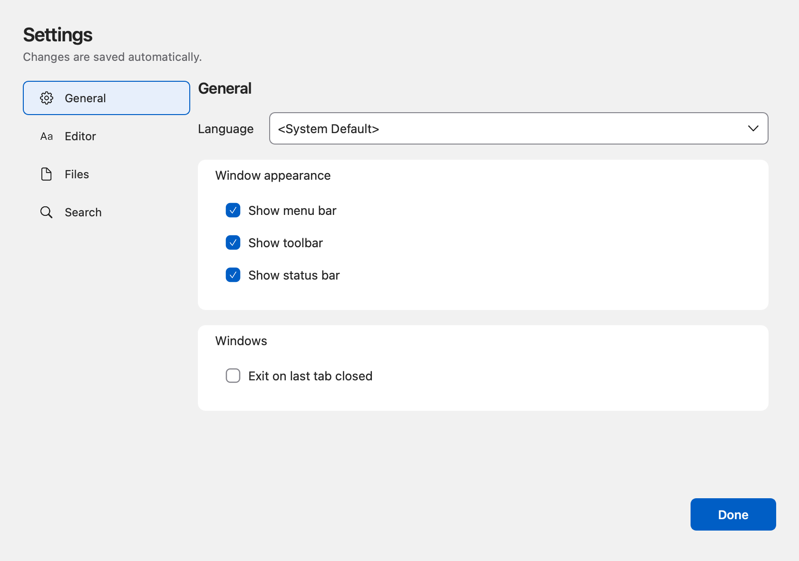
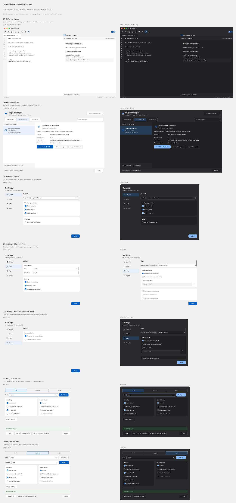

# macOS UI 审视与原稿修订

2026-10-12。基于 `better-colors`、`better-layout`、`better-typography`，审视主编辑器、插件管理器、设置、查找/替换/标记及宏、列编辑对话框。保留原来的紧凑桌面工具密度，采用系统字体、原生符号和可复用的语义颜色。

[Figma 审视稿](https://www.figma.com/design/cJPphvdJ1ztsU0tzMFIBpD?node-id=42-11715)包含 14 个可编辑视图；[设置分类原型](https://www.figma.com/proto/cJPphvdJ1ztsU0tzMFIBpD?node-id=45-12075&starting-point-node-id=45%3A12075)可切换 General、Editor、Files、Search。历史插件注册与生命周期流程保留在同一文件中。原稿反映颜色、布局和控件状态；Qt 与 Figma 的字体度量、系统窗口装饰仍有细微差异。

## 颜色：语义角色与实际背景

| 严重度 | 位置 | 修改前 | 修改后 | 原则与影响 |
| --- | --- | --- | --- | --- |
| HIGH | `src/NativeDialogs.cpp:94` | 窗口深色时，部分 Cocoa 指示器仍按系统浅色外观绘制 | 复选、单选指示器按窗口颜色绘制；选中状态保留勾、圆点 | 使用实际背景；避免状态难以辨认 |
| MEDIUM | `src/NativeAppearance.h:19`; `src/dialogs/PluginManagerDialog.cpp:137` | 编辑器、管理器和旧对话框分别维护颜色值 | 共用颜色角色；Figma Light/Dark 语义变量引用基础色 | 主题通过角色切换，减少各处独立漂移 |
| MEDIUM | `src/NativeDialogs.cpp:235` | 搜索结果仅改变文字颜色 | 成功、错误有独立文字与表面颜色，同时保留结果文案 | 颜色不单独承担含义 |
| MEDIUM | `src/dialogs/PluginManagerDialog.cpp:145` | 静态提示与资源状态使用交互蓝色 | 静态说明使用正文、次级文字；主操作使用填充强调 | 同一颜色维持一致含义 |

计算依据是 WCAG sRGB 相对亮度公式；完整前景/背景值见 [对比证据](evidence/MacUiReviewContrast.json)。下表列出实际声明的、不透明颜色对。截图确认了对应控件背景；没有声称进行了全屏逐像素或 APCA 审计。

| 颜色对 | Light | Dark | 本次检查阈值 |
| --- | ---: | ---: | ---: |
| 正文 / 内容表面 | 15.523 | 14.015 | 4.5 |
| 次级文字 / 窗口背景 | 5.370 | 7.194 | 4.5 |
| 主按钮文字 / 主按钮填充 | 6.163 | 8.098 | 4.5 |
| 成功文字 / 成功表面 | 6.446 | 6.635 | 4.5 |
| 错误文字 / 错误表面 | 5.902 | 7.392 | 4.5 |
| 输入边界 / 输入表面 | 3.664 | 3.664 | 3.0 |

沿用项目的十六进制颜色。只添加有实际使用者的角色与基础色；没有生成未消费的颜色阶梯。纯白保留为有意采用的浅色文档表面。禁用状态不纳入上述正常文字阈值。

## 布局：分组、对齐与渐进展开

| 严重度 | 位置 | 修改前 | 修改后 | 原则与影响 |
| --- | --- | --- | --- | --- |
| HIGH | `src/NativeDialogs.cpp:140` | 样式化 Cocoa 下拉框丢失展开箭头 | 原控件上显示原生符号，点击继续交给原下拉框 | 交互元素有明确可见提示 |
| MEDIUM | `src/dialogs/PreferencesDialog.cpp:154` | 设置集中在一个滚动表单 | 四个分类；内容可滚动，Done 保持可达 | 按任务分组，关键操作不随内容裁切 |
| MEDIUM | `src/dialogs/PreferencesDialog.cpp:186` | Language 等字段偏向中央 | 标签和输入沿内容共同边缘对齐 | 减少不必要的对齐边缘 |
| MEDIUM | `src/dialogs/FindReplaceDialog.cpp:182` | 模式、透明度和动作密集堆叠 | 保留模式条、匹配/搜索分组；透明度收进 More Options；结果与动作独立 | 组内 8 px、组间至少 16 px；低频项有可见入口 |
| MEDIUM | `src/NativeAppearance.cpp:99` | 高频、低频按钮在工具栏中同等占位 | 高频保留，保存全部、剪贴板、显示和宏操作进入 More | 根据使用频率确定层级；保留原 QAction 和菜单 |
| MEDIUM | `src/NativeDialogs.cpp:181` | 分类文字按单行固定高度处理 | 根据文字换行计算行高；支持 RTL 排列 | 避免扩展文字被裁切 |
| MEDIUM | `src/MacSymbols.mm:23` | 提议正方形栅格尺寸使宽符号变形 | 保留符号自然宽高比；增加 ellipsis/minus 比例回归 | 保持图形识别度，Figma 使用同源图标 |

原生检查覆盖主编辑器 1200×760、820×560；设置 840×590、720×500；搜索 740×540、660×460；以及各工具对话框默认尺寸。检查了 Files 的 RTL、扩展分类标签、小窗口高级选项滚动与固定动作区域。较长内容需要滚动，完整选项不要求同时出现在最小窗口内。

## 字体：层级与桌面密度

| 严重度 | 位置 | 修改前 | 修改后 | 原则与影响 |
| --- | --- | --- | --- | --- |
| MEDIUM | `src/NativeDialogs.cpp:35`; `src/dialogs/PreferencesDialog.cpp:181` | 对话框标题与分类标题层级重复 | 标题 20、分类 16、正文 13、说明 12、短注释 11 px | 下级标题不压过上级标题 |
| MEDIUM | `src/dialogs/MacroSaveDialog.cpp:36`; `src/dialogs/MacroRunDialog.cpp:42`; `src/dialogs/MacroEditorDialog.cpp:59`; `src/dialogs/ColumnEditorDialog.cpp:63` | 使用旧表单布局与不一致动作 | 复用系统字体、间距和单一主操作；图标附带可访问名称 | 让相同任务保持相同阅读与操作顺序 |
| LOW | `scripts/design/figma-ui-view-helpers.js:13` | 原稿各处自行指定文字外观 | 复用原稿文字样式；新增 Section、Help，UI 仅使用 SF Pro | 收敛字号与字重，减少设计漂移 |

Figma 中代码采用原文件已有的 Cousine；原生编辑器采用用户字体设置，新配置默认 Menlo。两者都与界面文字区分。原生表单沿用桌面工具的紧凑密度，没有直接套用网页的正文或触控尺寸。

## 功能与验证

- 设置：键盘切换分类、Tab 进入表单、字体和搜索设置双向同步及持久化、Esc 关闭。
- 查找：Enter 查找、计数、替换/全部替换、正则模式联动、标记/清除、Unicode 结果反馈与历史恢复。
- 宏与列编辑：空名称不能保存、无宏时不能运行、中文名称、运行次数信号、列插入与单次 Undo。
- 插件：临时配置下的注册、显式本地安装、启用、预览与退出回归。线上 GitHub 用例为 opt-in，本次跳过；之前的发布与更新证据保留在 `MacUiGitHub.zh-CN.md`。
- 开启插件构建：PluginSourceTests 18 通过；PluginApplicationTests 12 通过、1 跳过；PluginApplicationExitTests 8 通过。基础构建：PluginApplicationTests 13 通过。数字为 QtTest 报告总数，包含初始化与清理。

一轮中曾出现打包子进程等待与退出超时，同时检查发现管理器样式参数多余和同一外观反复重设样式的问题。已修正样式参数并跳过不变的样式更新；最终完整重跑通过。没有将这一轮超时的全部原因归因于已证实的单一机制。

证据：[原生回归](evidence/native-dialog-ui-tests.log)、[基础构建](evidence/native-dialog-ui-base-tests.log)、[CodeGraph](evidence/mac-dialog-ui-codegraph.log)。开发版位置为 `build/plugin-dev/NotepadNext.app`，不涉及正式签名、公证或发布。

**Not verified**：VoiceOver 全流程、200% 系统文字放大与最大可访问字号、所有真实翻译语言、Intel Mac、Windows/Linux 视觉回归、系统打印/文件选择对话框的重新设计。已执行的 RTL 与扩展标签检查不能替代这些检查。

**Approve**：限于上述已经检查的 macOS 视图、尺寸和交互，没有剩余的 HIGH 问题。其余应用页面与未验证平台不在此结论内。
