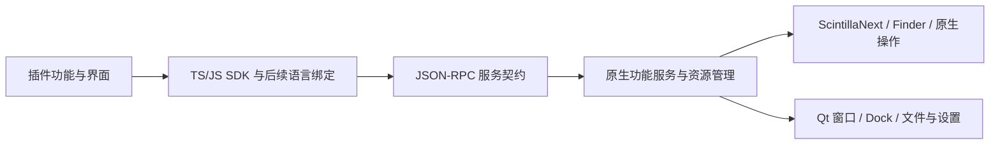

# Notepad Next ++ 原生插件 SDK 设计

**状态：架构设计，2026-10-12；2026-10-13 阶段 B 开发分支已实施。** 实际已实现的 API 以 [Phase B 状态](NativeSDKPhaseBStatus.zh-CN.md)、[SDK Phase B 指南](../../packages/plugin-sdk/docs/PhaseB.zh-CN.md)和 [SDK Native API 0.2](../../packages/plugin-sdk/docs/NativeAPI.zh-CN.md)为准。本文保留 A/B/C 的完整设计；下方 [候选完整声明](sdk-design/native-api.d.ts) 仍包含未实现的方法，不能直接当作发布 API。SDK 模板由独立仓库维护。

2026-10-13 的当前开发顺序、范围与验收标准由 [Phase B 计划](NativeSDKPhaseBPlan.zh-CN.md)维护。本文下方“实施前基线”和原始 inventory 保留为历史设计，当前源码盘点见 [Phase B inventory](sdk-design/phase-b-api-inventory.json)。

用户目标是：把 Notepad Next 已有编辑功能和方法包装为稳定 SDK，让插件组合、复用和增强编辑器。编辑器保持自己的文档、选区、分屏、搜索、语言和宏模型。VS Code 插件可作为代码/功能参考；其运行时适配实验独立保留，不作为原生 SDK 的依赖或发展目标。

## 1. 从现有软件能力出发

本次核对了核心头文件、实现、现有插件桥及增量代码图。内部 C++ 的 public 方法不是对外插件 API：例如 `MainWindow::saveFile` 会切换编辑器并弹出 Save As，菜单 lambda 依赖 `currentEditor()`；它们需要增加明确目标、返回值和生命周期约束后才能开放。

| 能力域 | 已有实现入口 | SDK 设计入口 | 实施前基线 |
| --- | --- | --- | --- |
| 当前/打开文档、未保存正文、修改事件 | `DocumentBridge`、`EditorManager` | `documents.getActive/list/getInfo/getSnapshot/watch` | 当前正文/事件已开放；直接列表和丰富元数据待桥接 |
| 文本编辑与撤销 | `DocumentBridge::applyEdits`、Scintilla undo action | `documents.applyEdits` | 版本检查与一组 edits 一个 undo 已开放；选区 guard 待新增 |
| 光标、多选区、矩形选择 | Scintilla selection 系列、`MainWindow` 选区操作 | `editors.capture/getSelections/setSelections` | 编辑器已有，SDK 待桥接 |
| 行操作、大小写、注释、排序 | `ScintillaNext`、`ScintillaSorter`、原生菜单 | `core.execute` 稳定命令目录 | 编辑器已有，需提取公共操作服务 |
| 新建、打开、保存、关闭、重新加载 | `MainWindow`、`ScintillaNext`、`EditorManager` | `files.create/open/save/close`，后续 reload/saveCopy | 编辑器已有，SDK 待桥接；保留用户未保存数据提示 |
| 查找、替换、统计、搜索结果 | `Finder`、`FindReplaceDialog`、`SearchResultsCollector` | `search.findAll`，替换通过 document transaction | 已有同步搜索；独立参数服务及有预算任务待桥接 |
| 当前语言、语言列表、EOL、BOM | `NotepadNextApplication`、Lua 语言数据、`ScintillaNext` | `languages.list/set`、document metadata、后续 EOL 操作 | 编辑器已有，SDK 待桥接 |
| 书签、标记、折叠 | `BookMarkDecorator`、`MarkerAppDecorator`、Scintilla folds | `bookmarks`、`core`、plugin-owned `decorations` | 用户书签/折叠已有；插件资源所有权需桥接 |
| 导出、复制 HTML/RTF | `Converter`、`MainWindow::exportAsFormat/copyAsFormat` | 后续 `exports.render`、独立 clipboard 服务 | 编辑器已有，SDK 待桥接 |
| 宏录制和执行 | `MacroManager`、`Macro` | 后续 `macros.list/run` | 原生宏已有；稳定 ID、作用域和执行边界待桥接 |
| 标签页、分屏、跳转 | `DockedEditor`、`MainWindow::switchToEditor` | `editors.revealRange/split` | 原有 dock 移动可复用；没有共享正文的克隆视图承诺 |
| 文件夹视图 | `FolderAsWorkspaceDock` | 后续 `folders.getRoot` | 当前为文件夹根目录视图；不引入 IDE project/workspace 模型 |
| 命令、菜单、工具栏、图标 | `PluginEngine`、manifest contributions | `commands.register`、静态 contributions | 已开放；上下文快照与编辑器右键位置待新增 |
| 预览和交互面板、本地 HTML 服务 | `WebviewService`、SDK service helper | `webviews.create/createHtml/createService` | fragment/service 已开放；完整 HTML 使用现有渲染基础，新增原生命名入口 |
| 消息、插件配置/数据、日志 | `PluginSession`、`PluginDataService`、diagnostics | `window`、`configuration`、`storage`、`log` | 消息与插件数据已开放；SDK 日志 facade、原生配置表单待完善 |

[实施前机器可读盘点](sdk-design/native-api-inventory.json)记录当时的候选状态、优先级及源代码位置；它不是阶段 A 落地后的支持列表。代码图只辅助追踪：Qt signal/lambda、Lua 和继承的 Scintilla 调用有未解析边，关键行为另以源码核对，不把图的命中数当作覆盖率。

## 2. 三层 API 与宿主边界



**基础服务**提供文档读写、选区、事件、面板、消息及插件数据。插件据此实现新的格式化、转换、检查、预览或工具功能。

**原生功能服务**提供编辑器已经具备的去重、排序、注释、折叠等操作。首批使用稳定命令目录，后续增加搜索、语言、书签、文件、导出、宏等专门接口。插件无需复制编辑器内部算法。

**高级扩展点**按需要添加，例如补全 provider、格式化 provider、结构化语言定义、编辑器右键 contributions。这些需要新的宿主注册/调度/资源管理；不能把现有功能包装与新宿主能力混为一谈。

公开入口以 `PluginContext` 提供服务。JS/TS 使用 Promise；Python 可使用 async 绑定。协议数据是 JSON 值、稳定 ID、范围和版本。SDK 不公开 Qt widget/QObject、原始 C++ 指针、任意 `SCI_* send` 或 Lua 执行入口。Scintilla 的底层调用包含字节位置及进程内指针，适合作为内部实现，不适合作为跨进程的公共协议。[Scintilla 官方接口](https://www.scintilla.org/ScintillaDoc.html)

JSON-RPC 2.0 保留为传输/调用标准；它没有定义编辑器 API、权限、事件流和生命周期，这些由本 SDK 契约规定。[JSON-RPC 规范](https://www.jsonrpc.org/specification)

### 2.1 先补原生操作服务，再开放菜单功能

在宿主加入 `EditorOperations`、`FileOperations`、`SearchService` 等小型服务。原生菜单和 SDK 都调用同一服务，不把 UI lambda 原样复制到插件桥，也不让插件通过任意 QAction objectName 执行内部动作。

首批原生命令候选：`edit.undo`、`edit.redo`、`edit.case.upper/lower`、`edit.comment.toggle`、`edit.lines.deduplicate`、`edit.lines.sort`、`view.fold.all`。每项目录注明参数、所需 capability、文档/视图副作用、选区范围规则和是否产生新的 undo 记录。Undo/Redo 操作已有 undo 栈，不能外包一层新 undo action。

同 ID 的服务规则固定；菜单标签、图标、Qt 对象名称及所在菜单不属于该 ID 的契约。SDK 同时校验 command 的服务许可与具体操作的许可：拥有 `core.commands@1` 不自动获得写文档、保存文件或改变视图的权限。

## 3. 文档、编辑器与编辑事务

### 3.1 保留编辑器自身模型

`documentId` 标识正文；`editorId` 标识显示它的编辑器实例；`windowId` 标识所属窗口；`panelId` 标识插件面板。ID 由宿主生成，关闭后失效，不等于文件 URI、tab index、QObject 地址或 pluginId。重命名不改变 documentId，关闭再打开会得到新 ID。插件没有持久占有用户文档的权利。

当前 `DocumentBridge` 绑定 Scintilla 控件；`PluginEngine` 只绑定一个窗口。首版保持单插件宿主窗口范围，在内部加入 editor/window 身份，不宣称任意多窗口或一个正文多个克隆视图已实现。现有 `DockedEditor::splitToRight/splitToBottom` 是移动已有 dock，SDK `split` 也使用此语义。

插件命令在用户点击时捕获发起窗口和编辑器身份，回调收到 `CommandInvocation`。后续操作显式使用该目标，不能在异步等待后反复读取“此刻活跃的编辑器”来决定写入对象。用户切换 tab 不应把原命令写到新的文档。

### 3.2 坐标和捕获

SDK 继续使用零起始 `{line, character}`，character 计数 **UTF-16 code units**，Range 为 `[start, end)`。UTF-8 字节位置转换只在原生桥进行。Emoji、代理对、CRLF、中文和 combining characters 都需测试；不允许范围切开代理对。矩形选择及虚拟空白另有字段，不用字符串 offset 假装覆盖所有选区。

`editors.capture(invocation)` 在 GUI 线程一次取得目标文档版本、正文和选区 revision，返回 `EditorCapture`。首批文本变换只接受普通 stream 多选区且无虚拟空白；不支持的模式明确报错或由插件提示，矩形/virtual-space 的变换放到后续专门契约。读取完整正文仍受当前 2 MiB 快照限制。

### 3.3 一次提交、可撤销、拒绝过期输入

`documents.applyEdits(documentId, expectedVersion, edits, {selectionGuard})` 的基线是现有 DocumentBridge；新增选区 guard 使“针对选区”的变换同时校验文档版本和选区 revision。

- 全部 edit 按同一旧正文坐标解释；先检查 readonly、范围、编码、数量、预算及重叠，再一次提交。
- 操作绑定明确 documentId；不接受插件自己提供的裸字节指针。
- 文档编辑 batch 产生一个 undo step；失败不能只应用一半。版本是单调 revision，插件不假设每次只加一。
- VersionConflict、SelectionConflict、DocumentClosed 等在提交前失败。用户编辑不被覆盖，SDK 不自动重试旧变换。
- 服务不得等待插件持有跨 RPC/await 的 beginUndo/endUndo 锁。关闭、停用和更新不能留下跨调用事务。
- Timeout/断线若发生在提交之后，写入结果可能未知；不回报“肯定未写入”，不自动重发。operationId 用于记录/诊断，首次版本不承诺跨会话持久去重。
- AbortSignal 是 SDK 的取消接口。只读/排队任务可取消；已到原子提交点的写入返回已提交结果。不能把取消包装成内容回滚。

打开、保存、Save As、关闭等改变文件状态的行为独立于正文编辑事务。`files.close` 首版仅支持 `prompt` 或 `ifClean`；原始 omitModifications/强制丢弃、批量删文件和无提示退出不列入首批自动化 API。Save As 弹窗期间目标 tab 可能变化，服务必须持有原文档 ID 并再次核验，不能复用 `currentEditor()` 假设。

### 3.4 搜索和大文件

首批桥接字面量搜索，返回命中范围及读取版本，不改变用户 Find 对话框、目标范围或选区。替换由明确 edit transaction 完成。多文档修改逐文档提交并报告结果，不宣称跨文档磁盘事务。

原生已有正则搜索，但现有同步 `Finder/QRegexSearch` 没有 SDK 所需的硬中断保障。正则、大范围批量查找另设能力/验收门槛：引擎一致性、零长度匹配、结果预算、GUI 响应、取消及超时/隔离策略。不把加一个 Promise 当作异步或可取消实现。

分块 `readRange` 作为后续服务，必须真正只读指定范围并核验版本，不能内部悄悄退回全文快照。现有 applyEdits 会检查完整快照；大于 2 MiB 的正文修改尚未作为首批桥的能力。Notepad Next 原生的大文件功能保留；SDK 明确报告当前可操作范围。

## 4. UI、插件生命周期和权限

### 4.1 插件界面增强

manifest 声明命令、插件菜单/toolbar 与 icon；安装后由用户启用，运行时绑定回调。首批新增编辑器右键 contributions 时，宿主计算 `hasDocument`、`hasSelection`、`writable` 等有限条件，插件不运行任意菜单表达式。

简单信息/选择/打开保存交互使用原生 Qt 控件；复杂界面使用主题化 Webview。保留三种面板：

| 类型 | 用途 | 基线 |
| --- | --- | --- |
| Fragment | 安全渲染、Markdown 预览 | 现有 `create/setHtml` 与文档 revision 检查 |
| Full HTML | 本地 HTML/CSS/JS 的交互工具 | 现有 WebEngine 渲染基础，新增 `createHtml` 原生命名 |
| Service | 激活所属 Node HTTP 服务和网页 | 现有 `createService`、owned endpoint/nonce 校验 |

新的浏览器桥使用 `acquireNotepadNextApi()`，提供 postMessage、JSON 状态和主题通知。现有 `acquireVsCodeApi()`/`createCompatible` 名称可作为旧包迁移别名保留，不让新原生插件依赖 VS Code 模块或适配器。HTML 渲染与状态桥属于通用面板能力。

面板资源采用 host 分配的 URI，只映射被验证的包内资源和授权文档资源。本地服务沿用本 activation 的 loopback endpoint、session 证明和自有路径范围；服务 helper 在插件停止时释放连接。Node 任意后端内存不在热更新恢复范围内。

### 4.2 lifecycle 分清安装状态和执行状态

```text
资源已注册 → 用户安装 → 已安装/停用 → 用户启用 → 等待激活事件
等待激活 → 激活并暂存资源 → Active
Active → 停止接纳新回调 → 清理/关闭会话 → 停用
Active → 更新候选包 → 新 activation 恢复资源 → 成功切换 / 失败回滚
```

安装和启用不等于立即运行；activationEvents 支持原有 onCommand/onLanguage/onStartup，onStartup 应显式声明。activate 用于注册回调和资源，不修改用户文本、抢焦点或运行菜单命令。只有成功发布的 Active generation 可执行编辑/数据写入；后台回调与 browser/service 请求也必须核验 generation。

每个订阅、命令、面板、临时标记和受管理服务属于 pluginId/session/generation，停用或进程退出统一清理。`subscriptions` 仍保留为显式组织方式，宿主同时记录所有权；不能只依赖插件主动 dispose。

更新时暂停旧 generation 的新工作，在受限预算内捕获 JSON state 和浏览器可恢复状态，保留原 dock/placement。候选 activate 后调用按 viewType 注册的 restorer；全部关键面板恢复并健康后切换，失败保持/恢复前一个版本。保留未保存预览源码、位置和滚动；不回放 Open 菜单命令，也不把更新解释为主窗口重启。

旧 generation 未完成的 callback、写入和 response 在新会话中无效。停止信号传播至 SDK `stopping`/AbortSignal。生命周期中的 HTTP 服务、timer 和事件资源也受停止控制。

### 4.3 capability 与配置范围

沿用已实现的文档、命令、消息、Webview、插件数据 capability，新增选区/视图/native-operation 服务分别协商。所需 capability 与具体作用范围在每个方法的契约中标明。methods 可组合，但不能用一个“execute 任意 native action”绕过所有许可。

- `commands@1`：本插件命令注册。
- `documents.read@1`、`documents.events@1`、`documents.write@1`：当前已有文档能力。
- `editors.selection.read/write@1`、`editors.view.write@1`：候选选区/视图操作。
- `core.commands@1`：候选目录入口；具体行编辑还需 documents.write，视图操作还需 view.write。
- `webviews@1`、`webviews.restore@1`、`webviews.service@1`：现有面板/恢复/service 基础；候选 full HTML 命名为 webviews.html。
- `files.open/save@1`、`search@1`、`languages.read/write@1`、`bookmarks.read/write@1`、`decorations@1`：后续桥接 capability 草案。

`configuration` 是本插件的设置，`storage` 是本插件的状态；不直接暴露整个 ApplicationSettings/QSettings。全局字体、主题等先只读白名单及主题 token；持久修改用户偏好属于独立、明确的后续接口。用户书签和插件装饰分开：插件不能随意占用 Scintilla marker/indicator 编号或停用时删掉用户书签。

独立 Node/Python 进程避免插件崩溃直接带走 Qt，但当前可信本地插件可以自行调用 Node fs/network。上述 capability 控制宿主 RPC，不等于 OS 沙箱。SDK 与管理器必须如实表达这个当前执行模型，不以方法许可承诺完整系统隔离。

## 5. 首批 API、例子与验收

首批让三个具体插件类别成立：已有 Markdown 预览、已有 HTML/JS 服务工具、新增原生文本工具。编辑器自己的功能成为可组合组件，而非为预览窗口设计一个专用 SDK。

[文本工具设计示例](sdk-design/examples/native-text-tools.ts)展示两条路径：获取原子文档/选区 capture → 用 JS 做大写转换 → 带 version 和 selectionGuard 提交；以及直接调用原生去重服务。声明具体验收 capabilities 和 API 版本，不能靠“完整类型定义”冒充宿主实现。

| 阶段 | 交付 | 验收 |
| --- | --- | --- |
| A：原生编辑基础 | documents 列表/元数据、selection capture/guard、稳定 core 命令目录、错误和能力查询；保留命令/面板/数据基础 | 中文/Emoji/CRLF、多选区转换一次 undo；切换 tab/选区不写错；readonly/closed/conflict 不部分提交；原生去重/排序与菜单行为一致 |
| B：功能覆盖 | 文件/保存语义、字面量搜索、语言、书签、插件装饰、跳转/既有 split、导出、宏 | Save As 取消保留正文，关闭提示正确；书签不被插件清理；搜索不改用户 Find 状态；停止释放装饰/订阅；复制/导出无隐式覆盖文件 |
| C：按插件需求扩展 | 原生配置表单、编辑器右键菜单、补全/格式化 provider、结构化语言定义等 | 具体插件 demo，性能/冲突/回调预算、用户焦点与 UI 一致性；每项能力单独协商 |

阶段 A 已实现单窗口身份、固定目标 command invocation、文档 list/getInfo、selection capture/guard/setSelections、八项共享原生命令和原生 HTML 命名入口；现有 watch/getActive/getSnapshot 契约继续保留。readRange、revealRange/split、统一新事件形状、持久 operationId 等未进入首版公开 API。API A 不包含 SDK 全功能已完成的承诺。B/C 按依赖和实际插件需求实施。大型 IDE 的调试、终端、远程工作区和外部编辑器通用兼容不作为本 SDK 的基础任务。

测试分三类：SDK 纯函数/模板与类型检查；共享 JSON contract/method/error fixtures；原生 Qt 行为和 UI 流程。mock 不能代替实际文件、undo、选区、主题或热更新验证。验收还包括 activation 写入限制、断线不自动重试写操作、旧会话资源失效、两插件互不清理对方资源、原生正文和 UI 在插件失败后可继续使用。

## 6. 版本、迁移与分仓安排

应用版本、SDK 包 SemVer、公开 host API、wire profile、manifestVersion 和插件包版本分别管理。阶段 A 使用 native API 0.2，阶段 B 开发分支新增明确 opt-in 的 native API 0.3，均通过 SDK 的 `./native` export 提供。完整候选类型仍是设计资料；实际实现与边界以 [Phase B 状态](NativeSDKPhaseBStatus.zh-CN.md)为准。

已有 API 0.1 插件按其协商的契约继续运行。新的 callback context、selection guard、native core 服务需新方法/schema 或 API 0.2 profile；不得在旧 invoke 的 args 前悄悄插入新参数。现有 Markdown/HTML ID、来源、installed data 和历史 Release 保留。热更新能力沿用通用模型。

按照用户本次授权完成三仓分工：

| 仓库 | 归属 |
| --- | --- |
| 主应用 | Qt/Scintilla 原生服务、RPC、runtime、资源/进程/权限与原生验收 |
| SDK | 原生 API 类型/Schema、各语言绑定、模板、调试/打包、文档和客户端测试 |
| Marketplace | 第一方插件源码/目录、固定 SDK 版本、独立插件 Release |

VS Code 实验性 importer/adapter 独立于核心 SDK，并非 schema/配置或运行时的必需依赖。SDK 的公开命名和 browser bridge 回归 Notepad Next ++ 自身。历史兼容实验保留在独立 experimental 区域；原生 SDK、主应用和 Marketplace 的版本固定与发布顺序见 [三仓边界](../../packages/plugin-sdk/docs/RepositoryLayout.zh-CN.md)。

本次来源包括 [ScintillaNext](../../src/ScintillaNext.h)、[MainWindow](../../src/dialogs/MainWindow.h)、[Finder](../../src/Finder.h)、[DockedEditor](../../src/DockedEditor.h)、[DocumentBridge](../../src/plugins/documents/DocumentBridge.h)、[PluginEngine](../../src/plugins/runtime/PluginEngine.h) 和 [WebviewService](../../src/plugins/webviews/WebviewService.h)。这是实施前工作树的设计盘点，实际阶段 A、版本与验证由 NativeSDKStatus 和正式 SDK 类型定义记录。
