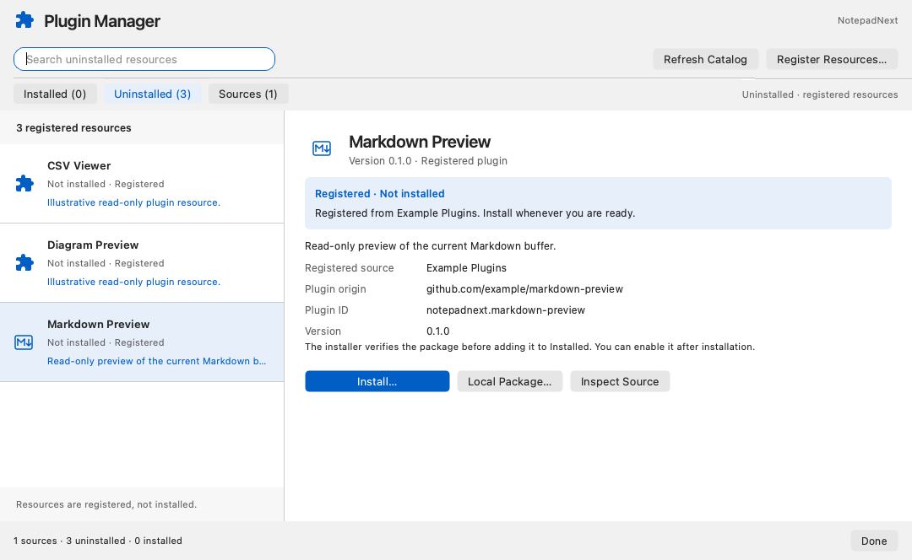
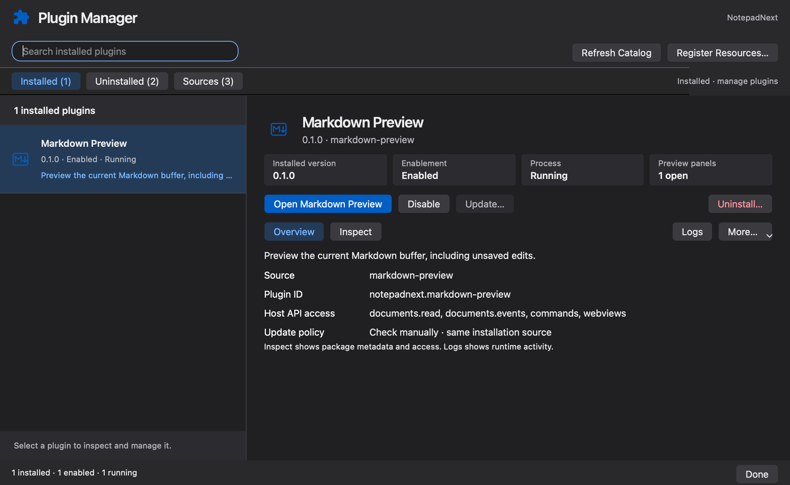

# Plugin Manager 界面与窗口修复

2026-10-11，本机 macOS arm64 / Qt 6.10.0。

界面参照 [Figma 注册列表和来源设计](https://www.figma.com/design/cJPphvdJ1ztsU0tzMFIBpD?node-id=23-8653) 与 [生命周期设计](https://www.figma.com/design/cJPphvdJ1ztsU0tzMFIBpD?node-id=11-1925)，实现为 Qt Widgets。使用原稿的 1080×664 初始尺寸、336 像素列表、24 像素详情边距、20/13/11 像素字体层级、浅蓝选中行和提示卡片；系统深色主题使用相同布局。最小窗口 820×560，详情可纵向滚动。标题继续使用通用拼图图标，内置 Markdown 样例使用从原稿下载的 SVG。

Installed 显示版本、启用、进程及面板数量，常用命令为主按钮。Overview 和 Inspect 在同一详情区域切换；Inspect 展示运行入口、宿主访问和最近日志。More 提供 Reload、Roll Back 和 Raw Metadata。Uninstalled 的本地资源有明确的蓝色 Install Local Package…，GitHub 资源有 Install… 及本地包备选入口。Sources 保留搜索、查看未安装资源、刷新、Inspect 和移除；注册仍不会直接安装或运行代码。注册输入对话框沿用相同间距和提示样式。

窗口问题在修改前的回归中记录到了首次创建面板触发一次 `SurfaceAboutToBeDestroyed`。Qt WebEngine 的内部视图使用 QQuickWidget；[Qt 的官方说明](https://www.qt.io/blog/qt-quick-and-widgets-qt-6.4-edition)解释了首次动态插入纹理控件会让 Qt 6 更换顶层绘图窗口。现在 `PluginEngine::attachWindow()` 在主编辑器首次显示之前调用 `PluginWebviews::prepareWindow()`，创建一个宿主拥有、零尺寸、不可聚焦的空 QQuickWidget。它随编辑器存活，不加载页面或运行插件；插件面板的创建和销毁不会再触发首次绘图模式切换。

修复后的测试要求首次打开及三次关闭重开均不销毁原生窗口，窗口 ID、位置、未保存内容保持不变。真实 Application 测试也检查从管理器打开插件后管理器隐藏、主窗口可见、窗口 ID 与编辑器对象不变；从注册和文件选择开始，完成本地安装、Markdown 预览及退出清理。面板数量通过延迟创建的 WebviewService → PluginSession → PluginEngine 事件更新，避免运行状态已经改变而卡片仍显示旧数量。

本次针对受影响路径验证，不替代先前协议、权限和平台的完整验收。原始结果及截图见 `evidence/UiWindowValidation.json`。本次没有配置 Developer ID、公证或发布流程。

